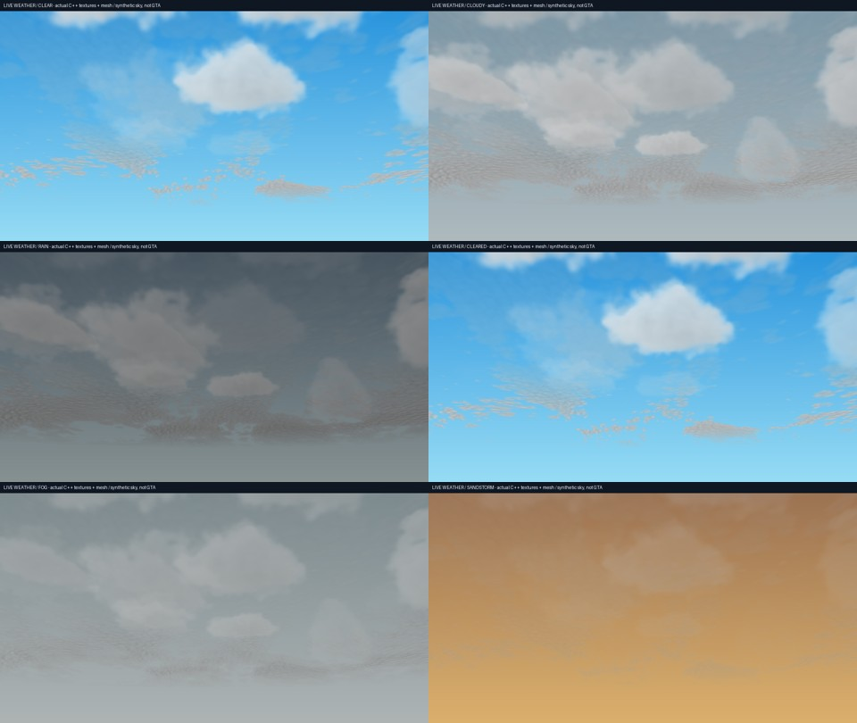
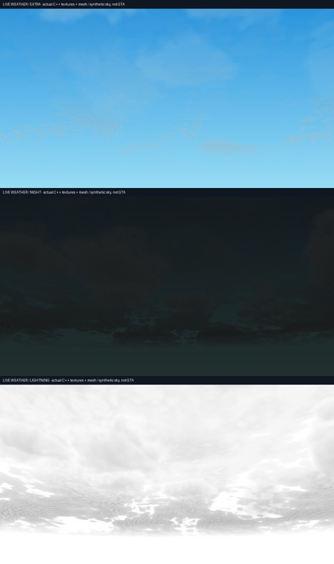
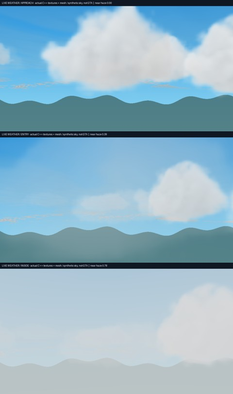
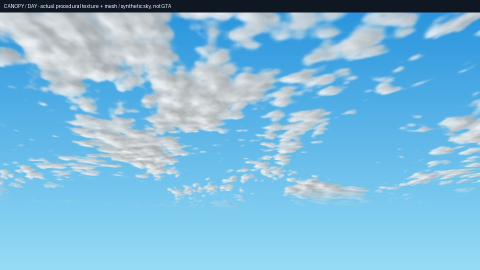
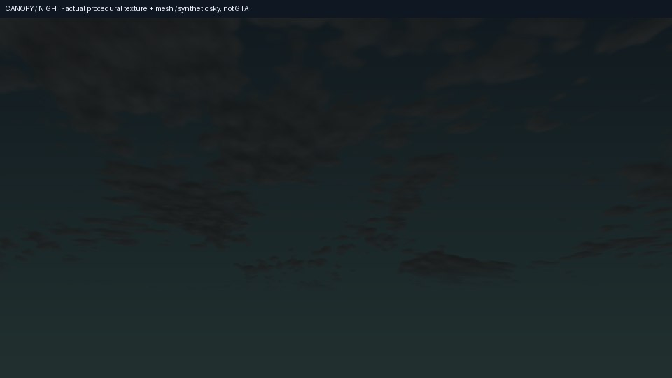
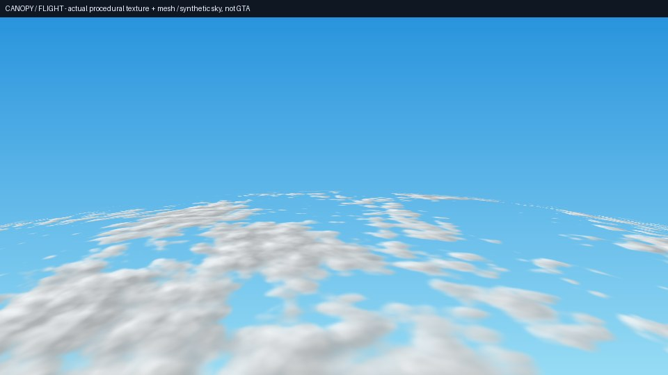

# VolumetricCloudsExtended.SA

A procedural replacement for GTA San Andreas' stock intersecting-card volumetric clouds.
The default renderer bakes original 3D cloud density into ordinary textured meshes and combines
them with a distant procedural canopy. It is fixed-function at runtime, not a per-frame
raymarched atmospheric volume. It only
replaces the volumetric cloud call in the original 3D effects pass. The sky background,
low clouds, moving fog, rain and other effects remain native.

## Install

Use desktop GTA SA **1.0 US**, an ASI loader, and the Win32 ASI from the GitHub
Actions build. Put it in the game directory (or an ASI-loader-supported mod directory).
The plugin creates `VolumetricCloudsExtended.ini` beside the ASI on first load and
does not overwrite an existing INI. Restart the game after editing the settings.
The accompanying log reports whether the executable and call target matched.

An unrecognized executable or an already redirected volumetric-cloud call is left
untouched. Other graphics modifications that affect the main camera/RenderWare
pipeline may still need compatibility testing.

## Renderer

- World-space cloud groups drift with the game wind and time step, not camera yaw.
- Fixed altitude band: flying upward no longer relocates the entire cloud layer.
- Area-uniform placement, bounded minimum spacing at spawn, and perimeter recycling
  after a cloud leaves view. Teleports rebuild the field around the new position.
- Smooth weather interpolation in both directions, including bad-to-bad transitions.
  Excess clouds fade out instead of remaining permanently allocated.
- Clustered native-texture clouds (mode 1): fixed crossed core
  with independently placed, deterministically tilted satellite cards,
  depth-sorted and angle-weighted. No camera-facing billboards. Increasing
  the puff count does not simply multiply opacity.
- Crossed cards (mode 0) preserve the native world-axis geometry.
- **Hybrid density-baked clouds (default, mode 2):** original ray-integrated
  3D cloud density, multiple fixed capture directions, coarse depth-reprojected
  meshes and a distant curved world-XY canopy. No camera yaw, pitch or roll
  rotates cloud geometry. View weights change with the actual eye-to-cloud
  position; cloud centers, shapes and capture planes remain world-fixed.
  `HybridClouds=0` selects the inexpensive canopy-only renderer.
  Optional native flight cards remain disabled by default.
- Frustum rejection, actual camera far-plane limit, smooth range and near fades,
  back-to-front view-depth ordering and bounded RenderWare batches.
- Additional textures are borrowed directly from the loaded particle TXD. Missing
  names are ignored; the native cloudhigh texture is the fallback. No global game
  RNG consumption or native cloud-table reset. Only mode 2 owns generated ordinary RW texture rasters.

## INI controls

All earlier setting names are recognized (including the two legacy tint aliases).
New settings take their defaults if absent. Values are finite and clamped; invalid
text retains the default. Inline comments are supported.

| Setting | Default | Meaning |
|---|---:|---|
| TargetProcClouds | 160 | Group count in modes 0/1; coverage control in mode 2 (0 disables) |
| BadWeatherDensityMultiplier | 1.4 | Cloudy/rainy density relative to clear (0–3) |
| MinSpawnZ | 200 | Lower absolute altitude (hybrid formations stay within the band) |
| MaxSpawnZ | 650 | Upper absolute altitude |
| SpawnRadiusMin | 300 | Inner radius relative to camera; scaled if far clip is shorter |
| SpawnRadiusMax | 2200 | Outer radius; scaled to effective render distance |
| RenderMaxDist | 2200 | Hard requested distance cap, also limited by active camera |
| RespawnMaxDist | 2800 | Maximum recycling reference; clouds are not recycled while visible |
| WindMoveScale | 0.9 | Wind advection multiplier |
| MinSpacing2D | 45 | Desired horizontal spacing; bounded retries avoid stalls |
| SpawnFadeInSpeed | 0.02 | Fade speed per native time step (50 units/sec); also used for retirement |
| QuadFacingMin | 0.2 | Crossed-card mode only: minimum plane-facing weight |
| FarClipFadeRange | 450 | Requested distance fade width |
| FarClipFadeMargin | 80 | Margin before the active far plane |
| TimecycFarClipScale | 1.8 | Optional tighter timecycle-based cap, never extends projection |
| LightingMode | 0 | 0 = native high-cloud colour; 1 = custom tint, shade and haze |
| UseTimecycTint | 1 | Custom mode: use interpolated low-cloud/fluffy RGB |
| TimecycTintStrength | 0.20 | Custom mode: mix native sky grayscale and cloud tint |
| FluffyCloudBottomBlend | 0 | Custom mode: mix low-cloud and fluffy-bottom timecycle RGB |
| ColorBrightnessBoost | 64 | Addition to native sky luminance (64 is stock) |
| UseAdditionalTextures | 1 | Look for listed textures in particle.txd |
| IncludeOriginalTextureInRandom | 1 | Include native cloudhigh among variants |
| CloudTextureNames | cloud2,cloud3,cloud4 | Comma-separated names; up to 15 |
| RenderMode | 2 | 0 = crossed cards; 1 = clustered fixed world-space cards; 2 = hybrid density-baked clouds (default) |
| CumulusDensity | 0.95 | Mode 2: opacity of the cloud texture (0–1) |
| CumulusImpostors | 1 | Legacy key, accepted but ignored |
| HybridClouds | 1 | Mode 2: 3D-density-baked formations plus distant canopy; 0 = canopy only |
| CumulusNightLight | 1 | Mode 2: night illumination multiplier (0–2); smooth transition to daylight |
| CumulusContrast | 0.65 | Mode 2: directional relief and occlusion contrast (0–1) |
| CumulusRimStrength | 0.85 | Mode 2: subtle thin-edge illumination (0–1), no additive halo |
| CumulusDetail | 0 | Mode 2: 0 = two 512² canopy masks + 96² captures; 1 = two 1024² masks + 128² captures, same geometry |
| InteriorHaze | 0.85 | Hybrid mode: local density-sampled flight haze strength (0–1; 0 disables) |
| CanopyFlightClouds | 0 | Optional native crossed wisps near the canopy height (0–24); off for lowest cost |
| PuffsPerCloud | 5 | Mode 1: number of puffs (1–8); core uses three fixed planes, each satellite one |
| SizeScale | 1 | Group dimensions multiplier, or mode 2 world texture scale |
| Opacity | 1 | Overall cloud opacity multiplier (0–2) |
| NearFadeDistance | 25 | Fade near the camera; 0 disables |
| BottomShade | 1 | Custom mode only: bottom/vertical shading (1 disables) |
| HazeStrength | 0 | Custom mode only: blend distant cards toward sky-bottom RGB |
| UseGameFog | 0 | Use RW scene fog rather than the plugin's manual distance haze |
| Seed | 17321 | Deterministic local RNG seed |

**Lighting correction:** `LightingMode=0` now uses the native high-cloud vertex
colour from SA 1.0 US: average the six sky colour channels (integer division),
add `ColorBrightnessBoost` (native 64) and clamp to 255. All vertices use that
neutral brightness, with no extra puff/bottom shading or manual colour haze.
In modes 0/1 an older INI without `LightingMode` automatically uses this corrected lighting;
no need to delete or regenerate it. The custom lighting settings are retained,
but take effect only with `LightingMode=1`. `UseGameFog` is independently
configurable and defaults off, like the native pass.

For the stock appearance with the procedural field, use `RenderMode=0`,
`LightingMode=0`, `UseAdditionalTextures=0`, `UseGameFog=0` and
`ColorBrightnessBoost=64`. For a low-overhead clustered
configuration try `PuffsPerCloud=3`. The new renderer deliberately does not
extend the world/camera clip plane or change the game's native height-switch global.

## Hybrid procedural clouds (mode 2, default; no custom shaders)

Existing INIs are never overwritten. Explicit RenderMode=0 or 1 remains
unchanged. To switch an existing installation, edit and restart:

```ini
RenderMode=2
HybridClouds=1
CumulusDetail=0
CumulusDensity=0.95
CumulusContrast=0.65
CumulusRimStrength=0.85
CumulusNightLight=1
InteriorHaze=0.85
CanopyFlightClouds=0
Opacity=1
```

### Original 3D density, cheap 2D GPU sampling

The previous canopy solved rotation and cost but was too flat at aircraft
altitude. Mode 2 now has a second representation for nearer formations:

- **Three coherent 64³ density fields** (broad cumulus, rising cumulus and
  flattened banks). Smooth unions of ellipsoids and multi-scale erosion
  produce a continuous cloud body; no independently composited texture puffs.
- **26 captures per form:** eight azimuths at −60°, 0°, +60°, and both poles.
  CPU front-to-back integration uses Beer–Lambert extinction and six
  cardinal optical-depth bases for self-shadowing. Capture alpha and
  integrated depth come from the same field. Daylight remains neutral,
  with bounced ambient and modest edge scattering; night uses the actual
  sky palette. The atlas stores density/light coefficients, so changing
  the sun or timecycle does not rerun the ray integration.
- **World-locked proxies:** each capture has a fixed 5×5 depth mesh (32
  triangles). At most three neighboring captures blend using continuous
  angular weights, with glancing directions suppressed. No screen-aligned
  billboards, no camera-facing UV rotation, no elevation-driven orientation
  switches. Approximate normalized optical alpha reduces multiple-blend
  opacity buildup. Close views concentrate the continuous angular weights
  to reduce double contours. This is still an impostor; oblique/close
  silhouettes can ghost during transitions.
- **World placement:** deterministic jittered 440 m cells at default
  SizeScale, with positions advected by the same wind as the canopy.
  Coverage follows the same periodic macro density field and weather threshold.
  Cloud sizes and heights are stable while traveling. Fair weather favors
  cumulus, overcast brings more banks, rain favors rising and bank formations. Clouds fade with range
  and when the camera approaches the interior. The far canopy fades into
  these formations and is suppressed above the layer to hide the flat ring.
- **Budget:** up to 48 groups, three proxies per group, 32 triangles per proxy
  plus up to 960 canopy triangles and 8 haze triangles = 5,576 triangle
  conservative pre-culling upper bound. Actual visible count is frustum-culled; default diagnostic position
  yielded 25 clear and 32 rainy eligible groups before frustum culling.
  Proxies share one atlas and are grouped into bounded indexed Im3D batches
  without changing depth order. Default atlas 1024² RGBA (4 MiB GPU base),
  high detail 2048×1024 (8 MiB). No atlas mipmaps (prevent tile bleeding);
  transparent tile gutters with alpha fading before each image's edges.
  Default two canopy masks add ~2.67 MiB with mipmaps (total ~6.67 MiB
  default / ~18.67 MiB high detail). CPU coefficients are 8 MiB
  default / 16 MiB detail plus RGBA and RW staging. No screen render
  targets, 3D GPU texture, custom shaders or per-frame ray tracing.
- **Initialization:** slices of density, optical-depth planes and capture
  rows are generated on the game thread with a soft ~2 ms work budget per
  frame. Allocation, a single work unit and final RW upload are not hard
  time-bounded. The canopy is visible during generation; the hybrid fades
  in over ~2 simulated seconds after the atlas is uploaded. The initial
  light bake uses 32 rows/frame; normalized directional relighting uses
  32 rows/frame after at least 30 native timestep units and a meaningful sun
  change, then one full texture upload. Weather and day/night RGB do not
  wait for a relight; they are applied live in vertex colors. On allocation/upload failure the canopy remains active.
  For the absolute minimum cost set HybridClouds=0.
- **Flight haze:** retains three 24³ byte density grids (~40.5 KiB total)
  downsampled from the actual capture density, not an unrelated fog sphere.
  At most nine rays with six samples per nearby eligible group approximate
  local extinction. An eight-triangle screen-space alpha overlay gradually
  obscures the scenery on entry and clears on exit. No full-screen texture,
  shader or change to native fog settings. Set InteriorHaze=0 to disable.
- **Known limits:** approximated lighting and optical-depth interpolation,
  only three density archetypes, and the haze has no scene-depth input
  (it may also tint nearby visible geometry/vehicles). The formation and distant sheet are not
  mutually depth-sorted across the two passes. A real game test is needed
  for fill rate, all-angle alpha artifacts and low-end hardware.

References: [Harris and Lastra, Real-Time Cloud Rendering (2001)](https://www.cs.unc.edu/Research/ProjectSummaries/RealTimeCloudRendering/),
[FlightGear SimGear](https://github.com/FlightGear/simgear/tree/next/simgear/scene/sky),
and [CodeWalker drawable resource definitions](https://github.com/dexyfex/CodeWalker/blob/master/CodeWalker.Core/GameFiles/Resources/Drawable.cs).
The supplied GTA V cloud XML and RSC7 files were inspected strictly as design
reference; no extracted model, texture, game code or shader is included.
See the handoff for metadata observations.

### Native weather synchronization

Mode 2 takes the game's already-interpolated `CWeather::CloudCoverage`,
`Foggyness` and `ExtraSunnyness` every frame. Rainy and sandstorm intent are
interpolated from the old/new weather types and `InterpolationValue`.
The independently step-limited rain/dust particle intensities do not
hold the cloud field in an old weather state after a forced weather
change (script-forced rain can additionally contribute). Fog and dust
reduce cloud visibility, extra-sunny reduces coverage opacity, and
lightning follows `LightningFlash` immediately. Native interpolated sky
and timecycle colors set live brightness; ordinary weather changes no
longer initiate or wait for texture generation.

The canopy uses two correlated static masks: base coverage and extra
coverage. Their alpha composition matches both baked endpoints at full
geometry opacity; intermediate coverage and edge fades are approximate.
If the density multiplier is below one, the mask weights reverse.
Form membership stays deterministic while weather changes their opacity.
Modes 0/1 retain their existing weather behavior.

### Linux software diagnostics — live weather and flight







Actual generated RGBA atlases, C++ geometry and density-sampled haze
rendered in a Linux software diagnostic against synthetic skies and terrain,
not GTA screenshots. The weather montage uses the same world position,
sun direction and generated textures. The older hybrid and canopy images
remain historical references. To regenerate:

```sh
g++ -std=c++17 -O2 tests/hybrid_preview.cpp -o hybrid_preview
python tests/hybrid_preview.py ./hybrid_preview docs/previews
```

### The distant canopy (also available standalone with HybridClouds=0)


A curved, textured sky layer has been practical since the fixed-function
console era. References: [Quake III tr_sky.c](https://github.com/id-Software/Quake-III-Arena/blob/master/code/renderer/tr_sky.c)
(curved cloud texture coordinates), [OpenMW sky.cpp](https://github.com/OpenMW/openmw/blob/master/apps/openmw/mwrender/sky.cpp)
(scrolling UVs and weather transitions), [SimGear cloud.cxx](https://github.com/FlightGear/simgear/blob/next/simgear/scene/sky/cloud.cxx)
(layer altitude, thickness and coverage), and
[Adrian Courrèges' GTA V frame capture](https://www.adriancourreges.com/blog/2015/11/02/gta-v-graphics-study/)
(the game uses a sky dome and a distant cloud ring with seamless density and normal textures).
Here directional lighting and shape are baked into original procedural pixels,
not a copy of any game's assets, code or shaders.

- **Shape:** periodic, domain-warped multi-scale value noise and cellular
  billows form connected banks with gaps and finer detail. Coverage changes
  with the interpolated weather and configured group count/multiplier.
  The same cloud map drifts with native wind; the weather threshold exposes
  more or less of the same field via two precomputed optical-alpha masks
  rather than regenerating random clouds.
- **Light:** static grayscale density-gradient relief, two-scale occlusion,
  fine detail and thin-edge shading. Per-frame live vertex RGB supplies
  neutral daylight, weather dimming and restrained sunrise/sunset warmth;
  nighttime uses the timecycle sky, not the stock +64 night brightness floor.
  Modes 0/1 retain their exact native/custom lighting options.
- **Geometry:** 257 vertices and 480 indexed triangles in one 32-segment,
  8-ring shallow disk. Absolute layer altitude and world-XY UVs stay stable
  under yaw, pitch, roll and camera altitude. The finite disk is recentered
  horizontally to cover the active camera clip region; only its gentle
  outer curvature and distance fade are camera-relative. There is no
  facing sprite, texture rotation, or per-cloud sort in the default path.
  Near the surface the alpha fades locally to avoid a hard sheet crossing
  the camera. The two-sided mesh is depth-tested against world geometry.
- **Cost:** one or two fixed-function texture+alpha blend submissions, no
  per-frame cloud raymarch, custom vertex/pixel shader, screen copy,
  3D GPU texture or render target. Economy uses two 512² RGBA masks
  (~2.67 MiB with mipmaps); detail 1 uses two 1024² masks (~10.67 MiB
  with mipmaps). The CPU scalar map, RGBA and RW staging are freed after
  initial upload. No subsequent canopy texture uploads for weather or
  lighting. Empty masks are skipped; clear usually needs only one pass.
  Automatic RW mipmaps are requested, with non-mipmapped fallback if
  unavailable; detail allocation failure retries economy. Texture creation
  or upload failure falls back to mode 0 and logs it. All owned resources
  are destroyed at RW shutdown.
- **Flight:** the canopy is a thin fake cloud surface, not a true 3D volume.
  For additional local parallax use CanopyFlightClouds=12 (max 24); these
  native crossed wisps appear only near the center altitude, with
  altitude/range fading. They are optional because they add alpha overdraw
  and can reveal card geometry. The default purposely omits these optional native cards.

Mode 2 uses HybridClouds, CumulusDetail, CumulusDensity, CumulusContrast, CumulusRimStrength,
CumulusNightLight, InteriorHaze, TargetProcClouds, BadWeatherDensityMultiplier, SizeScale,
Opacity, Seed, WindMoveScale, the altitude and range/fade controls, and
UseGameFog. ColorBrightnessBoost sets the native luminance reference for
daylight; LightingMode and tint settings affect only native cards.
CumulusImpostors is accepted as a legacy no-op. PuffsPerCloud affects only
mode 1. Texture names, spacing, and group spawn radius controls apply to
native cards (including optional flight wisps), not the procedural sheet.

### Previous canopy-only Linux software previews

| Day | Overhead |
|---|---|
|  |  |
|  |  |
|  |  |

These render the actual C++ procedural texture and geometry against a
synthetic sky, clipping triangles at the near plane and perspective-correctly
sampling UVs. Not screenshots of GTA, no optional native wisps or RW mipmaps
simulated in this diagnostic. The above-layer view still exposes the sheet
at grazing angles. Real-game appearance, device behavior and GPU fill rate
remain to be validated. Historical cumulus images are previous versions.

## Build

Exact Plugin-SDK revision: [624a6a49265fd7a6fc63bda1611013ceabeacb8a](https://github.com/DK22Pac/plugin-sdk/commit/624a6a49265fd7a6fc63bda1611013ceabeacb8a)
(October 25, 2025). GitHub Actions builds the SDK and plugin using Visual Studio
2022 Win32 and uploads an ASI + PDB package. Local Windows build:

```powershell
$env:PLUGIN_SDK_DIR = "C:\path\to\plugin-sdk"
# From the pinned SDK checkout:
& "$env:PLUGIN_SDK_DIR\tools\premake\premake5.exe" vs2022 --file="$env:PLUGIN_SDK_DIR\tools\premake\premake5.lua"
msbuild plugin.sln /p:Configuration=Release '/p:Platform=Mixed Platforms' /t:plugin_sa /m
# From this repository:
cmake -S . -B build -G "Visual Studio 17 2022" -A Win32
cmake --build build --config Release
ctest --test-dir build -C Release --output-on-failure
```

Portable regression tests on Linux (no game required):

```sh
g++ -std=c++17 -O2 -Wall -Wextra -Werror tests/cloud_tests.cpp -o cloud_tests
./cloud_tests
g++ -std=c++17 -O2 -Wall -Wextra -Werror -Dnear= -Dfar= tests/canopy_tests.cpp -o canopy_tests
./canopy_tests
g++ -std=c++17 -O2 -Wall -Wextra -Werror -Dnear= -Dfar= tests/volume_tests.cpp -o volume_tests
./volume_tests
g++ -std=c++17 -O2 -Wall -Wextra -Werror -Dnear= -Dfar= tests/weather_tests.cpp -o weather_tests
./weather_tests
```

## Engine reference

Reviewed gta-reversed [Clouds.cpp](https://github.com/gta-reversed/gta-reversed/blob/85bce0be4bd3229eb5ef445d3a7ac2e611a994f4/source/game_sa/Clouds.cpp),
[app_game.cpp](https://github.com/gta-reversed/gta-reversed/blob/85bce0be4bd3229eb5ef445d3a7ac2e611a994f4/source/app/app_game.cpp),
 [TimeCycle.cpp](https://github.com/gta-reversed/gta-reversed/blob/85bce0be4bd3229eb5ef445d3a7ac2e611a994f4/source/game_sa/TimeCycle.cpp)
and [Weather.cpp](https://github.com/gta-reversed/gta-reversed/blob/85bce0be4bd3229eb5ef445d3a7ac2e611a994f4/source/game_sa/Weather.cpp)
and the supplied SA 1.0 function index and disassembly dump. The native renderer uses three orthogonal planes at
`0x716380` and is called during `RenderEffects` at `0x53E170`, after moving fog and before
searchlights/post-effects, **not** inside `CClouds::Render`. The original repository's
call site `0x53E1B4` is verified against the IDB disassembly (part 06, E8 C7 81 1D 00) and retained with a runtime opcode/target check.
See [handoff](new%20chat/HANDOFF.md) for implementation and verification details.

## Offline geometry previews

These images are generated from the actual portable cloud geometry using a **synthetic
texture and sky**, not GTA assets or an in-game capture. They illustrate placement
and the two geometry modes, plus the shared C++ lighting calculation; real-game
appearance must be tested separately. The last row uses identical geometry,
synthetic texture and illustrative sunrise palette; only lighting settings differ.

| Clear / clustered | Rain / clustered |
|---|---|
|  |  |
|  |  |

| Corrected sunrise (native colour) | Previous sunrise (full custom tint/shading) |
|---|---|
|  |  |

To regenerate the previews (requires Python, NumPy and Pillow):

```sh
g++ -std=c++17 -O2 tests/dump_preview.cpp -o dump_preview
python tests/preview.py ./dump_preview docs/previews
```

To regenerate the canopy previews:

```sh
g++ -std=c++17 -O2 tests/canopy_preview.cpp -o canopy_preview
python tests/canopy_preview.py ./canopy_preview docs/previews
```
