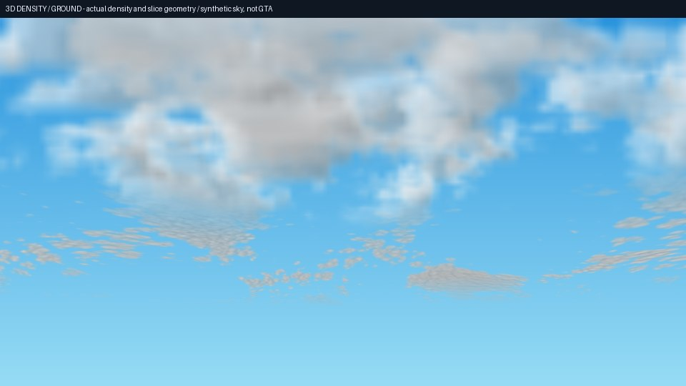
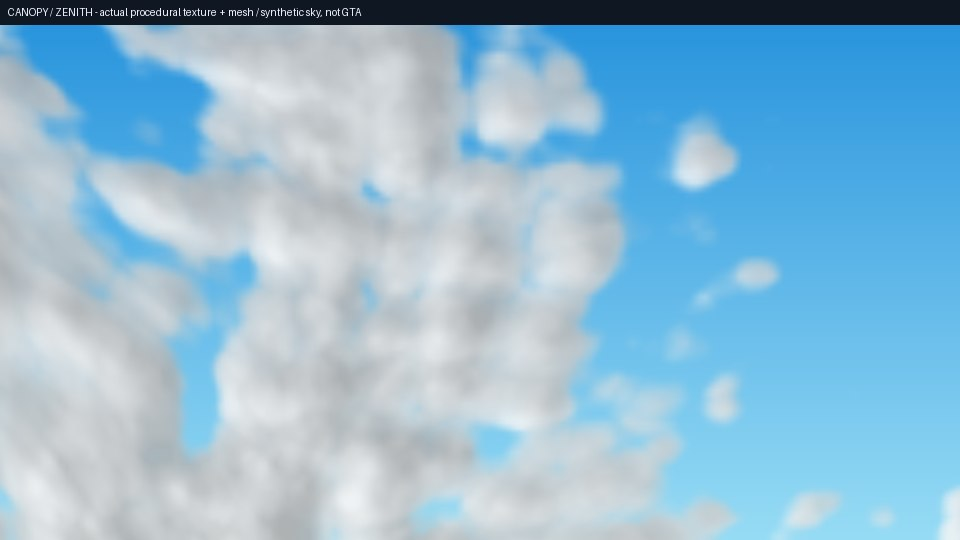
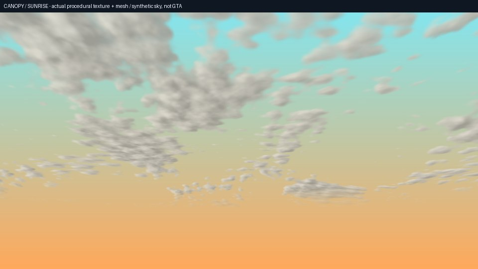
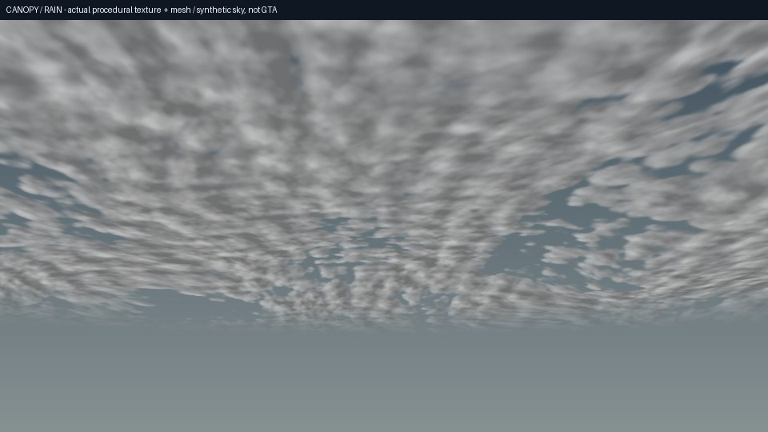

# VolumetricCloudsExtended.SA

A procedural replacement for GTA San Andreas' stock intersecting-card volumetric clouds.
The default renderer uses a cheap world-fixed canopy derived from the
actual 3D density, with a small nearby volume zone even on the ground.
The volume draw radius grows smoothly to its full range in flight. It uses hardware-filtered volume texture slices and
fixed-function blending, not a per-pixel raymarch shader. It only
replaces the volumetric cloud call in the original 3D effects pass. The sky background,
low clouds, moving fog, rain and other effects remain native.

## Install

Use desktop GTA SA **1.0 US**, an ASI loader, and the Win32 ASI from the GitHub
Actions build. Put it in the game directory (or an ASI-loader-supported mod directory).
The plugin creates `VolumetricCloudsExtended.ini` beside the ASI on first load and
does not overwrite an existing INI. Restart the game after editing the settings.
The accompanying log reports whether the executable and call target matched.
Keep the supplied `VolumetricCloudsExtended.cache` beside the ASI for a fast first launch.

An unrecognized executable or an already redirected volumetric-cloud call is left
untouched. Other graphics modifications that affect the main camera/RenderWare
pipeline may still need compatibility testing.

## Renderer

- World-space cloud groups drift with the game wind and time step, not camera yaw.
- Fixed altitude band: flying upward no longer relocates the entire cloud layer.
- Area-uniform placement, bounded minimum spacing at spawn, and perimeter recycling
  after a cloud leaves view. Teleports rebuild the field around the new position.
- Smooth weather interpolation in both directions, including bad-to-bad transitions.
  Excess clouds fade out instead of remaining permanently allocated.
- Clustered native-texture clouds (mode 1): fixed crossed core
  with independently placed, deterministically tilted satellite cards,
  depth-sorted and angle-weighted. No camera-facing billboards. Increasing
  the puff count does not simply multiply opacity.
- Crossed cards (mode 0) preserve the native world-axis geometry.
- **Continuous 3D cloud banks (default, mode 2):** the canopy's macro
  coverage drives a periodic, original 3D density field with billowing
  tops, flatter bases, and soft erosion. The nearby field is sampled by
  fixed-world-axis slice patches with absolute world XYZ texture coordinates.
  Neither rotating nor translating the camera moves the density-sampling
  planes. The nearby volume is always available; its range expands toward
  the full draw distance from 85% of the canopy height to the canopy,
  based on actual player or occupied vehicle Z, not camera orientation.
  `HybridClouds=0` selects the inexpensive original canopy-only renderer.
- Frustum rejection, independent mode 2 cloud range, smooth range and near fades,
  back-to-front view-depth ordering and bounded RenderWare batches.
- Additional textures are borrowed directly from the loaded particle TXD. Missing
  names are ignored; the native cloudhigh texture is the fallback. No global game
  RNG consumption or native cloud-table reset. Only mode 2 owns generated canopy rasters and optional D3D9 volume textures.

## INI controls

Fresh installations generate a small, commented INI (also included as
`VolumetricCloudsExtended.defaults.ini` in the ZIP). Existing INIs are
never rewritten. Copy the new example over only if you deliberately want
to reset your settings; otherwise add or update the atmosphere options below. Previous INIs keep their
old draw and fog distances, and any explicit UseAdditionalTextures setting.

| Setting | Default | Meaning |
|---|---:|---|
| RenderMode | 2 | 2 = continuous volume banks + distant layer; 1 = clustered classic cards; 0 = crossed classic cards |
| HybridClouds | 1 | Mode 2: nearby 3D plus shared-density canopy; full 3D range expands at 85% of canopy height; 0 keeps canopy everywhere |
| CumulusDetail | 0 | Economy (recommended); 1 = larger textures and more samples |
| TargetProcClouds | 160 | Sky coverage in mode 2; classic cloud group count otherwise; 0 disables |
| BadWeatherDensityMultiplier | 1.4 | Cloud density in bad weather relative to clear (0–3) |
| MinSpawnZ / MaxSpawnZ | 200 / 650 | Cloud layer height above sea level |
| SizeScale | 1 | Size of the cloud formations |
| WindMoveScale | 0.9 | Wind movement multiplier |
| Opacity | 1 | Cloud thickness (0–2) |
| Seed | 17321 | Repeatable cloud pattern |
| CloudDrawDistance | 8000 | Independent 3D and distant cloud visibility (300–12000 world units) |
| FarBillboards | 1 | Beyond the far threshold, transition to cheap volume-projected cards; 0 keeps the full volume |
| BillboardStartDistance | 5000 | Minimum distance for the billboard transition (5000–12000) |
| BillboardStartRatio | 0.8 | Also start no sooner than this fraction of CloudDrawDistance (0.5–0.95) |
| CloudFogStart / CloudFogEnd | 1600 / 8000 | Cloud-only colour haze starts/ends here. Equal values disable colour fog. |
| CumulusContrast | 0.65 | Strength of baked cloud relief (0–1) |
| CumulusNightLight | 1 | Cloud night brightness (0–2) |
| PuffsPerCloud | 5 | Mode 1 only: overlapping puffs per group |
| UseAdditionalTextures | 0 | Classic modes: opt in to additional textures from particle.txd |
| CloudTextureNames | cloud2,cloud3,cloud4 | Classic modes: optional extra texture names |

### Existing INIs and advanced compatibility controls

Older INIs remain readable. The following advanced keys are intentionally
not emitted in a fresh INI: most are only relevant to the classic card
renderer or duplicate useful controls above. Values are clamped and
malformed text is ignored.

- `RenderMaxDist`, `SpawnRadiusMin/Max`, `RespawnMaxDist`,
  `MinSpacing2D`, `SpawnFadeInSpeed`, `QuadFacingMin`,
  `FarClipFadeRange`, `FarClipFadeMargin`, `TimecycFarClipScale`:
  classic card simulation/range controls. Mode 2 does not read the game's
  far clip or timecycle fog distance for cloud visibility.
- `LightingMode=0`: classic neutral native brightness (average sky RGB +
  stock 64). Explicit `LightingMode=1` enables the older tint and shading
  options: `UseTimecycTint`, `TimecycTintStrength` (also
  `TimecycleTintStrength`), `FluffyCloudBottomBlend` (also
  `TimecycTintSkyInfluence`), `BottomShade`, `HazeStrength`.
  `ColorBrightnessBoost` sets the original luminance reference.
- `UseGameFog` is classic-only: it has no influence on mode 2.
- `IncludeOriginalTextureInRandom` remains a classic-only override.
- `CumulusDensity`, `CumulusRimStrength`, `InteriorHaze`, and
  `NearFadeDistance` retain their existing behavior as advanced overrides.
  For most users, `Opacity`, `CumulusContrast`, and the defaults suffice.
- Removed unused `CumulusImpostors` and optional `CanopyFlightClouds`:
  the latter mixed old card wisps into mode 2 and is no longer needed.

To switch an existing installation to the recommended renderer:

```ini
RenderMode=2
HybridClouds=1
CumulusDetail=0
CloudDrawDistance=8000
CloudFogStart=1600
CloudFogEnd=8000
FarBillboards=1
BillboardStartDistance=5000
BillboardStartRatio=0.8
UseAdditionalTextures=0
```

## Continuous 3D cloud banks (mode 2, default)

### Independent cloud atmosphere

Mode 2 uses its own distance and colour-haze parameters for **both** the
volume banks and distant canopy. It uses the current sky palette instead
of the world's active fog colour and parameters. Radial fog is calculated
per vertex from world distance; D3D9 applies it via specular alpha on
pretransformed vertices, after texture blending, without a fog overlay or
a second full-screen pass. Weather changes still control live cloud
coverage, lighting and visibility.

The game's original projection and viewport are preserved. Local cloud
fragments use their normal scene depth. Triangles crossing the original
far clip are split, and cloud geometry beyond it is assigned the maximum
scene depth while retaining the correct XY projection and reciprocal W.
It can therefore occupy sky pixels but remains behind rendered scene
geometry. No edits to the camera far plane, fog globals or world drawing
distance; the game's fog and post-processing continue as normal. Hardware
without vertex fog instead fades distant cloud opacity. Standard D3D9
depth-buffer precision and other mods' rendering remain limitations.

See Microsoft's [vertex fog documentation](https://learn.microsoft.com/en-us/windows/win32/direct3d9/vertex-fog)
and [pure-device GetViewport documentation](https://learn.microsoft.com/en-us/windows/win32/api/d3d9/nf-d3d9-idirect3ddevice9-getviewport).

### One density field with world-fixed samples and far LOD

- **Shape:** original periodic multi-scale 3D noise distorts a smoothed
  version of the canopy coverage. Height envelopes, irregular crowns,
  erosion and a flatter base form continuous banks. XYZ density remains
  in world space, translated by native wind, including during flight.
- **Lighting:** precomputed optical-depth accumulation down the cloud
  column and four oblique density taps, a local density gradient and a
  soft multiple-scattering proxy reveal shaded interiors and billows.
  Finer erosion and subtle crown highlights add relief, with a lighter
  scattering floor rather than a global brightness boost.
  Native sky/timecycle RGB and lightning are applied live, with daylight
  headroom for SA’s post-processing colour filter. This is approximate
  baked relief, not dynamic directional shadowing.
- **Rendering:** hardware-filtered RGBA volume textures (128×128×32
  each, clear/overcast endpoints) sampled on fixed world X/Y/Z plane
  lattices. Unlike the previous camera-centred shells, every plane retains
  its position during translation as well as rotation. Nearby world cells
  use 20m steps, smoothly transitioning to nested 40m/80m steps as
  distance increases (detail: 16/32/64m; vertical spacing fits the slab).
  Ray-angle weights select the dominant world axis and smoothly blend
  the two axes near a diagonal rather than suddenly switching entire
  stacks. Spatial bricks are culled by AABB/frustum and conservative
  density occupancy, with finer patches near the camera/diagonals.
  Constant-time periodic occupancy prefix sums reject empty blocks.
  Bricks are ordered back to front in their spatial hierarchy. Intersecting
  planes in the diagonal blend have approximate rather than exact
  per-pixel ordering. The indexed volume uses fixed-function pixel
  blending; a tiny optional hardware vertex program handles projection,
  UV, ray weights, opacity and fog. Existing depth testing, no depth
  writes, and no screen render targets. Sparse, nested sampling and interpolated vertex
  weights can still cause some residual finite-sampling artifacts; this
  is not per-pixel raymarching.
- **Range:** CloudDrawDistance now controls actual volume geometry.
  The previous 1400m radius and tile-size-dependent limit are removed.
  With billboards off, fixed slices extend to the configured range (with
  squared distance opacity taper beginning at 75%). With far billboards
  on, the first transition distance is max(5000m, 0.8 × CloudDrawDistance)
  by default; the transition ends 10% of the draw distance later
  (at least 350m, not beyond draw distance). At 8000m, that means full
  3D up to 6400m, blended 3D/cards to 7200m, cards beyond. At 4200m,
  there are no billboards. The two geometric representations crossfade
  over distance, not camera height or heading.
- **Far LOD:** the exact clear/wet volume is projected front-to-back
  into two small 512² atlases, 16 overlapping periodic world cells ×
  8 azimuths. Smooth partition-of-unity cell weights reduce seams;
  the optical integration supplies real volume silhouette and shading,
  not stock cloud sprites. Upright cards face the *camera position*
  (not direction), with adjacent azimuth images alpha-crossfaded and
  radially sorted. The transition is deferred at extreme flight height
  rather than drawing edge-on upright cards from above. All cards share
  a single batch. Guards prevent atlas
  bleeding; no atlas mip chain is allocated. Far LOD is optional, and
  volume remains active over the full range if the atlas cannot be
  prepared/uploaded or if unusually tiny cells would require too many
  cards. Directional blending and slab projection are approximations.
- **Altitude handover:** nominal canopy height is
  `MinSpawnZ + 0.52 * (MaxSpawnZ - MinSpawnZ)` (434m for 200–650m).
  A small true-volume zone (630m default at street level) grows to
  1200m before 85% of that height, then expands to the full range from
  85% to 100% (~368.9–434m). The cheap distant canopy fades where the
  nearby volume contributes and retains the previous faint distant
  underlay at full flight altitude. The transition changes distance,
  not the density or opacity of nearby clouds. The actual player or
  vehicle Z controls it, not camera pitch. Both rendering paths sample
  the same period, wind, weather endpoints and baked luminance.
  If the volume fails, keep the full relief canopy; `HybridClouds=0`
  retains a standalone inexpensive curved 2D sheet.
- **Cost (potato hardware):** mode 2 keeps the identical world-density,
  sampling lattice, weather, optical weights and far atlas. VS 2.0 hardware
  vertex processing replaces CPU per-corner square roots, fades, projection
  and polygon clipping. The ordinary game projection clips near clouds;
  a complementary cloud-only projection and depth-only viewport range
  draw clouds beyond the map far plane. Hardware clipping, not a flattened
  entire triangle, preserves occlusion. Both draw passes reuse one
  DISCARD-streamed vertex buffer and a static reversed quad index buffer.
  The canopy and far LOD remain fixed-function. No pixel shader, ray
  marcher, new render target or additional texture fetch is introduced.
  Pure/software/unsupported devices have the original CPU path; hardware
  failures switch to that path rather than disabling 3D. No runtime shader
  compiler or external DLL is needed (FXC runs at build time).
  Source geometry is bounded below 44k vertices. At the reference pose
  roughly 7850 triangles and 76 distant cards are preserved. A same-host
  480-pose Linux mesh-only benchmark: previous mesh 1.18ms, optimized
  CPU mesh 1.14ms, GPU-input mesh 0.43ms, all ~7276 triangles average
  (excludes legacy CPU projection and hardware draw). These are not GTA
  FPS or Intel HD measurements. A subsequent compact vertex/patch pass
  on the same 480-pose benchmark reduced GPU-input mesh time from 0.422
  to 0.321ms and CPU fallback mesh time from 1.200 to 0.944ms, preserving
  all 7276 average triangles and 14552 vertices. Each hardware vertex is
  16 bytes instead of 28 (43% less streamed data); the static index buffer
  eliminates CPU index generation entirely on the hardware path.
  The next optimization skips the portion of the reversed static index
  buffer that lies wholly outside each pass's homogeneous clip plane.
  Per-brick conservative bounds include a float precision guard; the
  remaining submission keeps original order and crossing geometry, with
  at most one draw per projection. No sampling or opacity changes.
  On 480 moving poses with a 450m scene far clip, average hardware input
  shrank from 29,105 to 19,025 vertices across both passes (-34.6%).
  The GPU-input mesh (including range selection) took 0.268ms vs 0.323ms;
  CPU fallback mesh 0.848ms vs 0.918ms on the local host. Both CPU and
  hardware source buffers are byte-identical to the previous revision.
  The GPU still bears the fill-rate cost of translucent clouds.
  All generated textures are greyscale with independent 8-bit opacity:
  use lossless A8L8 when the device advertises the format and required
  filtering, otherwise use full-resolution RGBA. Economy texture storage
  is ~4.33 MiB if all resources support A8L8 (~8.67 MiB RGBA); detail
  ~14.33 MiB (~28.67 MiB RGBA). Actual driver allocations may differ.
  No per-frame density/texture generation, weather uploads or screen copy.
- **Compatibility:** the direct D3D9 draw carries actual three-component
  texture coordinates, not a RenderWare 2D atlas. SA's normal pure-device
  mode is accepted. The SA 1.0 US device pointer and camera matrices are
  read directly (verified against the IDB); the SDK's device getter
  invalidates RW's matrix cache and is deliberately avoided. Pipeline
  state is captured/restored via D3DSBT_ALL, with no prohibited pure-device
  state getters. RW's pending states are flushed first. Canopy, banks and far billboards use native D3D9 textures/vertices in a shared state scope. Volume textures
  are uploaded through system-memory staging into the default pool; a
  managed-pool attempt and smaller power-of-two textures are tried on
  failure. Lower-capability hardware can use point sampling and, only
  if two-volume blending is unavailable, the nearest weather endpoint.
  No volume support or failed draws retain the canopy. Upload failures
  log the precise operation and HRESULT, and a successful first draw
  logs submitted fixed slice patch/triangle counts. A one-shot optional asynchronous
  GPU occlusion query records depth-passing samples without waiting.
  Device loss/reset and RW shutdown release owned resources.
- **Initialization / disk schematic:** `VolumetricCloudsExtended.cache`
  stores the two exact canopy masks, complete two-endpoint volume,
  conservative occupancy tables and optional far atlas. Version 2 stores
  luminance + opacity rather than duplicate RGB channels: the default
  economy file shrinks from 8,432,196 to 4,237,892 bytes (~4.04 MiB)
  without altering a texel. Version 3 retains the compressed byte layout
  but invalidates v1/v2 because the new shared-density artwork differs.
  The release ZIP includes a pre-baked default cache. Keep it beside the
  ASI. During RenderWare initialization a single sequential read validates
  the version, relevant bake settings, expected lengths and checksum.
  Missing, stale or corrupted files rebuild automatically. Replacement is
  atomic; an unwritable folder simply uses generated data. CPU data stays
  resident (~8.04 MiB expanded default schematic), including across game
  restarts within the same process and D3D9 device loss/reset. GPU textures
  are preloaded during startup; late ASI loaders retain the lazy fallback.
  Reset recovery reuploads from RAM without reopening the cache.
  No per-frame cache disk traffic and no writes on weather transitions:
  the immutable periodic schematic repeats seamlessly, with live wind UV
  offsets and live weather blending. A specific startup bake is only
  required if the cache is missing or its bake-related settings changed.
  Local 20-load warm filesystem benchmark: v1 16.8ms, v2 10.4ms; this
  excludes physical HDD seek/read latency and GPU uploads. Deleting the
  cache is safe; the exact same procedural field is rebuilt. The RAM is
  ordinary pageable memory; the mod does not pin it against OS paging.

The target is convincing 2013-era cloud volumes at 2004-game budgets,
not a recreation of Rockstar assets or renderer. References:
[Rockstar's RDR2 atmospheric rendering presentation](https://advances.realtimerendering.com/s2019/),
[GPU Gems 1, chapter 39: Volume Rendering Techniques](https://developer.nvidia.com/gpugems/gpugems/part-vi-beyond-triangles/chapter-39-volume-rendering-techniques),
[Direct3D 9 volume textures](https://learn.microsoft.com/en-us/windows/win32/direct3d9/volume-texture-resources),
[Direct3D 9 texture formats (A8L8)](https://learn.microsoft.com/en-us/windows/win32/direct3d9/d3dformat),
[Direct3D 9 performance optimizations](https://learn.microsoft.com/en-us/windows/win32/direct3d9/performance-optimizations),
[Indexed draw ranges](https://learn.microsoft.com/en-us/windows/win32/direct3d9/rendering-from-vertex-and-index-buffers),
[Direct3D 9 resource management](https://learn.microsoft.com/en-us/windows/win32/direct3d9/managing-resources),
[Unity community cloud renderer](https://github.com/jaagupku/volumetric-clouds)
(weather mask, vertical profile, erosion), and
[Project V Atmosphere](https://github.com/rsrodev/ProjectVAtmosphere)
(reference for modern volume costs, not copied code or architecture).
Additional historical references:
[Mark Harris, Real-Time Cloud Rendering for Games (GDC 2002)](https://markmark.net/PDFs/RTCloudsForGames_HarrisGDC2002.pdf)
(impostors to amortize fill rate),
[SkyX geometry blocks](https://osrf-distributions.s3.amazonaws.com/gazebo/api/4.0.0/GeometryBlock_8h_source.html)
(spatial subdivision),
[Direct3D 9 dynamic-buffer performance](https://learn.microsoft.com/en-us/windows/win32/direct3d9/performance-optimizations),
[vertex fog](https://learn.microsoft.com/en-us/windows/win32/direct3d9/vertex-fog),
and [viewport and clipping](https://learn.microsoft.com/en-us/windows/win32/direct3d9/viewports-and-clipping).
The new vertex shader intentionally preserves the existing volumetric look
instead of adding an expensive pixel-based lighting model.

### Native weather synchronization

Mode 2 takes the game's already-interpolated `CWeather::CloudCoverage`,
`Foggyness` and `ExtraSunnyness` every frame. Rainy and sandstorm intent are
interpolated from the old/new weather types and `InterpolationValue`.
The independently step-limited rain/dust particle intensities do not
hold the cloud field in an old weather state after a forced weather
change (script-forced rain can additionally contribute). Fog and dust
reduce cloud visibility, extra-sunny reduces coverage opacity, and
lightning follows `LightningFlash` immediately. Native interpolated sky
and timecycle colors set live brightness; ordinary weather changes no
longer initiate or wait for texture generation.

The canopy uses two correlated static masks: base coverage and extra
coverage. Their alpha composition matches both baked endpoints at full
geometry opacity; intermediate coverage and edge fades are approximate.
If the density multiplier is below one, the mask weights reverse.
On hardware with dual-volume support, the nearby volume interpolates two density endpoints in the same draw.
Modes 0/1 retain their existing weather behavior.

### Runtime validation and diagnostics

The Win32 CTest `cloud_d3d9_volume` creates a native D3D9 device (attempts SA's
pure-device flags first), uploads actual 3D textures with the same backend
as the ASI, draws the clear/intermediate/wet endpoints, and reads pixels
back to verify that changing the third texture coordinate changes the
output. The expanded tests check cloud-only vertex fog and foreground
occlusion outside the scene far plane, fog state restoration through a
subsequent native draw, native mipmapped canopy upload/draw, and the actual
perspective volume mesh with a 450m scene far clip at positions from the
flight recording. The new far-atlas regression draws the actual
volume-derived cards behind a 450m scene far clip.
A machine without a volume-capable D3D9 device reports **skipped**,
not passed. This does not test the GTA camera or integration.

The log beside the ASI distinguishes `3D cloud device:`,
`3D cloud bank ready:`, empty camera frustum, and
`3D cloud draw submitted:`. A supported occlusion query also logs the
first draw's depth-passing sample count. If the renderer falls back,
send the new log lines including HRESULT, not only the canopy screenshot.

### Historical Linux software diagnostics — density/mesh only

| Below 85% canopy height | Mid-handover (412m) |
|---|---|
|  |  |
|  |  |

Actual C++ textures and fixed world sampling geometry, software-rendered
with trilinear filtering against a synthetic sky; not GTA screenshots.
The portable regression checks actual common world-ray intersections
during yaw/pitch and up to 231m of translation, axis/LOD weight continuity,
and handover at custom canopy heights. This addresses the previous
camera-centred sampling motion but is not proof of perfect in-game
temporal stability. The updated ASI needs another flight test.

```sh
g++ -std=c++17 -O2 tests/banks_preview.cpp -o banks_preview
python tests/banks_preview.py ./banks_preview docs/previews ground entry flight above
```

### Standalone canopy (HybridClouds=0) and historical surface technique


A curved, textured sky layer has been practical since the fixed-function
console era. References: [Quake III tr_sky.c](https://github.com/id-Software/Quake-III-Arena/blob/master/code/renderer/tr_sky.c)
(curved cloud texture coordinates), [OpenMW sky.cpp](https://github.com/OpenMW/openmw/blob/master/apps/openmw/mwrender/sky.cpp)
(scrolling UVs and weather transitions), [SimGear cloud.cxx](https://github.com/FlightGear/simgear/blob/next/simgear/scene/sky/cloud.cxx)
(layer altitude, thickness and coverage), and
[Adrian Courrèges' GTA V frame capture](https://www.adriancourreges.com/blog/2015/11/02/gta-v-graphics-study/)
(the game uses a sky dome and a distant cloud ring with seamless density and normal textures).
Here directional lighting and shape are baked into original procedural pixels,
not a copy of any game's assets, code or shaders.

- **Shape:** periodic, domain-warped multi-scale value noise and cellular
  billows form connected banks with gaps and finer detail. Coverage changes
  with the interpolated weather and configured group count/multiplier.
  The same cloud map drifts with native wind; the weather threshold exposes
  more or less of the same field via two precomputed optical-alpha masks
  rather than regenerating random clouds.
- **Light:** static grayscale density-gradient relief, two-scale occlusion,
  fine detail and thin-edge shading. Per-frame live vertex RGB supplies
  neutral daylight, weather dimming and restrained sunrise/sunset warmth;
  nighttime uses the timecycle sky, not the stock +64 night brightness floor.
  Modes 0/1 retain their exact native/custom lighting options.
- **Geometry:** 257 vertices and 480 indexed triangles in one 32-segment,
  8-ring shallow disk. Absolute layer altitude and world-XY UVs stay stable
  under yaw, pitch, roll and camera altitude. The finite disk is recentered
  horizontally to cover the independent cloud range. Standalone canopy
  has gentle camera-relative outer curvature. The current hybrid mode
  instead uses the world-fixed relief proxy described below. There is no
  facing sprite, texture rotation, or per-cloud sort in the default path.
  Near the surface the alpha fades locally to avoid a hard sheet crossing
  the camera. The two-sided mesh is depth-tested against world geometry.
- **Cost:** one or two fixed-function texture+alpha blend submissions, no
  per-frame cloud raymarch, custom vertex/pixel shader, screen copy,
  3D GPU texture or render target. Economy uses two 512² RGBA masks
  (~2.67 MiB with mipmaps); detail 1 uses two 1024² masks (~10.67 MiB
  with mipmaps). Native D3D9 textures have alpha-weighted mipmaps; CPU
  source RGBA pixels are retained for lost/reset devices. The scalar map
  is freed. No subsequent uploads for weather or lighting. Empty masks
  are skipped, and clear usually needs only one pass. The same projected
  vertices are reused for both masks. On resource upload failure the
  plugin falls back to classic cards and logs the failure.
- **Flight:** the distant canopy remains a low-cost two-sided surface;
  the near volume supplies the actual 3D shape. Canopy-only mode remains
  available for weak hardware.

### Previous canopy-only Linux software previews

| Day | Overhead |
|---|---|
|  |  |
|  |  |
|  |  |

These render the actual C++ procedural texture and geometry against a
synthetic sky, clipping triangles at the near plane and perspective-correctly
sampling UVs. Not screenshots of GTA, no optional native wisps or RW mipmaps
simulated in this diagnostic. The above-layer view still exposes the sheet
at grazing angles. Real-game appearance, device behavior and GPU fill rate
remain to be validated. Historical cumulus images are previous versions.

## Build

Exact Plugin-SDK revision: [624a6a49265fd7a6fc63bda1611013ceabeacb8a](https://github.com/DK22Pac/plugin-sdk/commit/624a6a49265fd7a6fc63bda1611013ceabeacb8a)
(October 25, 2025). GitHub Actions builds the SDK and plugin using Visual Studio
2022 Win32 and uploads an ASI + PDB package. Local Windows build:

```powershell
$env:PLUGIN_SDK_DIR = "C:\path\to\plugin-sdk"
# From the pinned SDK checkout:
& "$env:PLUGIN_SDK_DIR\tools\premake\premake5.exe" vs2022 --file="$env:PLUGIN_SDK_DIR\tools\premake\premake5.lua"
msbuild plugin.sln /p:Configuration=Release '/p:Platform=Mixed Platforms' /t:plugin_sa /m
# From this repository:
cmake -S . -B build -G "Visual Studio 17 2022" -A Win32
cmake --build build --config Release
ctest --test-dir build -C Release --output-on-failure
```

Portable regression tests on Linux (no game required):

```sh
g++ -std=c++17 -O2 -Wall -Wextra -Werror tests/cloud_tests.cpp -o cloud_tests
./cloud_tests
g++ -std=c++17 -O2 -Wall -Wextra -Werror -Dnear= -Dfar= tests/canopy_tests.cpp -o canopy_tests
./canopy_tests
g++ -std=c++17 -O2 -Wall -Wextra -Werror -Dnear= -Dfar= tests/weather_tests.cpp -o weather_tests
./weather_tests
g++ -std=c++17 -O2 -Wall -Wextra -Werror -Dnear= -Dfar= tests/banks_tests.cpp -o banks_tests
./banks_tests
```

## Engine reference

Reviewed gta-reversed [Clouds.cpp](https://github.com/gta-reversed/gta-reversed/blob/85bce0be4bd3229eb5ef445d3a7ac2e611a994f4/source/game_sa/Clouds.cpp),
[app_game.cpp](https://github.com/gta-reversed/gta-reversed/blob/85bce0be4bd3229eb5ef445d3a7ac2e611a994f4/source/app/app_game.cpp),
 [TimeCycle.cpp](https://github.com/gta-reversed/gta-reversed/blob/85bce0be4bd3229eb5ef445d3a7ac2e611a994f4/source/game_sa/TimeCycle.cpp)
and [Weather.cpp](https://github.com/gta-reversed/gta-reversed/blob/85bce0be4bd3229eb5ef445d3a7ac2e611a994f4/source/game_sa/Weather.cpp)
and the supplied SA 1.0 function index and disassembly dump. The native renderer uses three orthogonal planes at
`0x716380` and is called during `RenderEffects` at `0x53E170`, after moving fog and before
searchlights/post-effects, **not** inside `CClouds::Render`. The original repository's
call site `0x53E1B4` is verified against the IDB disassembly (part 06, E8 C7 81 1D 00) and retained with a runtime opcode/target check.
See [handoff](new%20chat/HANDOFF.md) for implementation and verification details.

## Offline geometry previews

These images are generated from the actual portable cloud geometry using a **synthetic
texture and sky**, not GTA assets or an in-game capture. They illustrate placement
and the two geometry modes, plus the shared C++ lighting calculation; real-game
appearance must be tested separately. The last row uses identical geometry,
synthetic texture and illustrative sunrise palette; only lighting settings differ.

| Clear / clustered | Rain / clustered |
|---|---|
|  |  |
|  |  |

| Corrected sunrise (native colour) | Previous sunrise (full custom tint/shading) |
|---|---|
|  |  |

To regenerate the previews (requires Python, NumPy and Pillow):

```sh
g++ -std=c++17 -O2 tests/dump_preview.cpp -o dump_preview
python tests/preview.py ./dump_preview docs/previews
```

To regenerate the canopy previews:

```sh
g++ -std=c++17 -O2 tests/canopy_preview.cpp -o canopy_preview
python tests/canopy_preview.py ./canopy_preview docs/previews
```

### Lossless CPU geometry optimization

Mode 2 reuses each brick's eligible-axis mask, cached periodic occupancy
cell results and original squared LOD thresholds. The closest corner
minimizes both the radial and angular rejection metrics; only a corner
inside the original near-exclusion region needs the full four-corner
test. Out-of-range horizontal grid columns are discarded before their
vertical bricks are constructed. The mesh, depth order, texture data,
lighting and defaults are unchanged. The default 480-pose source-mesh
benchmark on one Linux host had a median 0.266 to 0.201 ms change over
five alternating runs (not a Celeron FPS measurement). The portable
test compares 300,000 candidate predicates against the original method;
a separate 1,440-pose old/new benchmark verifies identical CPU vertex,
index and GPU vertex/span bytes. See `new chat/HANDOFF.md` for reproduction
details.


### Shared-density canopy and restrained ground volume

The old sheet was a different texture from the 3D clouds, making ascent
look like a cloud replacement. The new hybrid canopy projects the actual
clear and overcast volume columns from below, front-to-back using the
reference-step opacity, then resamples premultiplied luminance/alpha.
It uses the same live weather blend and light modulation as the volume.
The height profile is a tiny 8x8 repeating table of density-weighted
column centroids (union of both weather states), derived sequentially
from the resident volume once at startup. The grid is world/wind
anchored; distance and frustum rejection limit geometry and only
visible shared vertices are emitted. The nearby volume is small at
ground level and expands with player altitude. Regional variations and
stronger crowns produce a mix of larger banks and small fragments;
no extra noise, volume texels, shader samples or cache bytes per frame.
The canopy still approximates a surface at distance, not a true cloud
raymarch. Added nearby 3D on the ground has nonzero GPU cost.

### Measuring the potato, not extrapolating it

For local source preparation, build and run:
```sh
g++ -O3 -std=c++17 -march=x86-64 -mtune=sandybridge tests/cloud_workload_benchmark.cpp -o cloud_workload
taskset -c 0 ./cloud_workload
taskset -c 0 ./cloud_workload --scene-load &
taskset -c 0 ./cloud_workload
# Stop the background --scene-load process after the test.
```
This measures actual cloud source construction, including the canopy
and far atlas, with an optional same-core synthetic scene-culling
competitor. It is **not** a Celeron emulation or GTA frame-time benchmark.

For real hardware, create an empty file named
`VolumetricCloudsExtended.profile` next to the ASI before launching.
The mod logs CPU pass time every 60 render calls and, if supported,
the matching asynchronous D3D9 GPU timestamp interval. No waiting or
flush is performed, disjoint samples are discarded, and unsupported
devices report CPU only. Remove the marker to disable profiling; ordinary
gameplay has no timing queries or log writes from this feature. Timings
refer to the cloud pass, not the complete game's frame. See
[Microsoft's D3D9 queries](https://learn.microsoft.com/en-us/windows/win32/direct3d9/queries).

Diagnostic software views (not GTA screenshots):
[Ground](docs/previews/new_ground.jpg) · [Looking up](docs/previews/new_zenith.jpg) ·
[Handover](docs/previews/new_entry.jpg) · [Above](docs/previews/new_above.jpg).

### Additional low-end optimization and automatic D3D9 workload

The cache and cloud art have not changed. At preload, derive byte-sized
Z-occupancy masks for every rectangle of the 16x16 periodic XY occupancy
grid. A query uses one table lookup plus a Z bit test instead of eight
prefix sum reads per active weather endpoint. Clear is normally a subset
of overcast; when it is not, build an exact union table. This uses 128 KiB
normally (192 KiB worst case); allocation failure keeps the existing exact
prefix queries. The existing v3 cache still loads without rebaking.

The VS2 hardware path retains its fixed, 16-byte world-space vertices in
the GPU buffer when the next mesh has identical bytes. No DISCARD lock,
new driver allocation or transfer is needed on such frames. CPU vector
storage is swapped, not copied. Camera, wind, weather and lighting uniforms
still update normally. Changed geometry is streamed immediately. The
three possible parity codes are decoded with two comparisons instead of
floor/min/max; no texture samples or lighting equations changed. The second
depth pass updates only matrix constants, and the viewport is set/restored
only when the distant pass requires it. The all-state snapshot object is
reused, but freshly captured every frame (released on device loss/reset).
See Microsoft's [state blocks](https://learn.microsoft.com/en-us/windows/win32/api/d3d9helper/nf-d3d9helper-idirect3dstateblock9-capture)
and [dynamic-buffer guidance](https://learn.microsoft.com/en-us/windows/win32/direct3d9/performance-optimizations).

There is no need to profile a player's PC to run the synthetic workload.
Win32 CI runs the real D3D9 cloud backend at 640x480 and 1024x768 with
clear and mixed weather, fixed and moving cameras, five altitudes, actual
texture uploads, cloud geometry, shader/fixed-function blend, and a depth
occluder. Each case has 4 warm-up and 24 timed frames. It reports source
preparation, driver submission, event-fenced completion, supported and
valid GPU timestamp intervals, submitted vertex counts, average streamed
bytes, exact VB reuse counts and alpha/depth-passing sample counts. The
reported adapter/driver identifies what was actually measured. The event
fence is benchmark-only, not a gameplay synchronization point. Negative
GPU timing/sample fields mean unavailable, not zero cost.

```powershell
build/Release/d3d9_volume_test.exe --benchmark 640 480
build/Release/d3d9_volume_test.exe --benchmark 1024 768
```

The Linux same-core stress benchmark and D3D9 synthetic yardstick are
complementary, not an emulation of the Celeron 847/Intel HD Graphics,
RenderWare world rendering, or shared-memory contention on that system.
Do not convert their timings into an alleged in-game FPS for that hardware.
