# VolumetricCloudsExtended.SA

A procedural replacement for GTA San Andreas' stock intersecting-card volumetric clouds.
This is a textured 3D impostor renderer, not a raymarched atmospheric volume. It only
replaces the volumetric cloud call in the original 3D effects pass. The sky background,
low clouds, moving fog, rain and other effects remain native.

## Install

Use desktop GTA SA **1.0 US**, an ASI loader, and the Win32 ASI from the GitHub
Actions build. Put it in the game directory (or an ASI-loader-supported mod directory).
The plugin creates `VolumetricCloudsExtended.ini` beside the ASI on first load and
does not overwrite an existing INI. Restart the game after editing the settings.
The accompanying log reports whether the executable and call target matched.

An unrecognized executable or an already redirected volumetric-cloud call is left
untouched. Other graphics modifications that affect the main camera/RenderWare
pipeline may still need compatibility testing.

## Renderer

- World-space cloud groups drift with the game wind and time step, not camera yaw.
- Fixed altitude band: flying upward no longer relocates the entire cloud layer.
- Area-uniform placement, bounded minimum spacing at spawn, and perimeter recycling
  after a cloud leaves view. Teleports rebuild the field around the new position.
- Smooth weather interpolation in both directions, including bad-to-bad transitions.
  Excess clouds fade out instead of remaining permanently allocated.
- Clustered native-texture clouds (default, mode 1): fixed crossed core
  with independently placed, deterministically tilted satellite cards,
  depth-sorted and angle-weighted. No camera-facing billboards. Increasing
  the puff count does not simply multiply opacity.
- Crossed cards (mode 0) preserve the native world-axis geometry.
- Experimental shader-free cumulus (mode 2): a pre-baked three-dimensional
  density field with self-shadowing, fixed axis-aligned texture slices for
  depth/parallax, and inexpensive whole projections farther away.
  All modes select their own fixed geometry automatically; yaw, pitch,
  roll and altitude no longer rotate the cards or their texture coordinates.
- Frustum rejection, actual camera far-plane limit, smooth range and near fades,
  back-to-front view-depth ordering and bounded RenderWare batches.
- Additional textures are borrowed directly from the loaded particle TXD. Missing
  names are ignored; the native cloudhigh texture is the fallback. No global game
  RNG consumption or native cloud-table reset. Only optional cumulus mode owns
  a small ordinary RW texture raster.

## INI controls

All earlier setting names are recognized (including the two legacy tint aliases).
New settings take their defaults if absent. Values are finite and clamped; invalid
text retains the default. Inline comments are supported.

| Setting | Default | Meaning |
|---|---:|---|
| TargetProcClouds | 160 | Clear-weather cloud groups (0–512) |
| BadWeatherDensityMultiplier | 1.4 | Cloudy/rainy density relative to clear (0–3) |
| MinSpawnZ | 200 | Lower absolute altitude |
| MaxSpawnZ | 650 | Upper absolute altitude |
| SpawnRadiusMin | 300 | Inner radius relative to camera; scaled if far clip is shorter |
| SpawnRadiusMax | 2200 | Outer radius; scaled to effective render distance |
| RenderMaxDist | 2200 | Hard requested distance cap, also limited by active camera |
| RespawnMaxDist | 2800 | Maximum recycling reference; clouds are not recycled while visible |
| WindMoveScale | 0.9 | Wind advection multiplier |
| MinSpacing2D | 45 | Desired horizontal spacing; bounded retries avoid stalls |
| SpawnFadeInSpeed | 0.02 | Fade speed per native time step (50 units/sec); also used for retirement |
| QuadFacingMin | 0.2 | Crossed-card mode only: minimum plane-facing weight |
| FarClipFadeRange | 450 | Requested distance fade width |
| FarClipFadeMargin | 80 | Margin before the active far plane |
| TimecycFarClipScale | 1.8 | Optional tighter timecycle-based cap, never extends projection |
| LightingMode | 0 | 0 = native high-cloud colour; 1 = custom tint, shade and haze |
| UseTimecycTint | 1 | Custom mode: use interpolated low-cloud/fluffy RGB |
| TimecycTintStrength | 0.20 | Custom mode: mix native sky grayscale and cloud tint |
| FluffyCloudBottomBlend | 0 | Custom mode: mix low-cloud and fluffy-bottom timecycle RGB |
| ColorBrightnessBoost | 64 | Addition to native sky luminance (64 is stock) |
| UseAdditionalTextures | 1 | Look for listed textures in particle.txd |
| IncludeOriginalTextureInRandom | 1 | Include native cloudhigh among variants |
| CloudTextureNames | cloud2,cloud3,cloud4 | Comma-separated names; up to 15 |
| RenderMode | 1 | 0 = crossed cards; 1 = clustered fixed world-space cards; 2 = experimental shader-free cumulus |
| CumulusDensity | 0.95 | Mode 2: optical density multiplier (0–1) |
| CumulusImpostors | 1 | Legacy key, accepted but ignored; mode 2 always uses fixed geometry |
| CumulusNightLight | 1 | Mode 2: night illumination multiplier (0–2); smooth transition to daylight |
| CumulusContrast | 0.65 | Mode 2: directional and underside lighting contrast (0–1) |
| CumulusRimStrength | 0.85 | Mode 2: subtle sunward edge softening (0–1), never above native daytime luminance |
| CumulusDetail | 0 | Mode 2: 0 = economy 64px tiles / 2×2 grid; 1 = 128px tiles / 3×3 grid, depth LOD farther out |
| PuffsPerCloud | 5 | Mode 1: number of puffs (1–8); core uses three fixed planes, each satellite one |
| SizeScale | 1 | Group dimensions multiplier |
| Opacity | 1 | Group opacity multiplier (0–2) |
| NearFadeDistance | 25 | Fade near the camera; 0 disables |
| BottomShade | 1 | Custom mode only: bottom/vertical shading (1 disables) |
| HazeStrength | 0 | Custom mode only: blend distant cards toward sky-bottom RGB |
| UseGameFog | 0 | Use RW scene fog rather than the plugin's manual distance haze |
| Seed | 17321 | Deterministic local RNG seed |

**Lighting correction:** `LightingMode=0` now uses the native high-cloud vertex
colour from SA 1.0 US: average the six sky colour channels (integer division),
add `ColorBrightnessBoost` (native 64) and clamp to 255. All vertices use that
neutral brightness, with no extra puff/bottom shading or manual colour haze.
An older INI without `LightingMode` automatically uses this corrected mode;
no need to delete or regenerate it. The custom lighting settings are retained,
but take effect only with `LightingMode=1`. `UseGameFog` is independently
configurable and defaults off, like the native pass.

For the stock appearance with the procedural field, use `RenderMode=0`,
`LightingMode=0`, `UseAdditionalTextures=0`, `UseGameFog=0` and
`ColorBrightnessBoost=64`. For a low-overhead clustered
configuration try `PuffsPerCloud=3`. The new renderer deliberately does not
extend the world/camera clip plane or change the game's native height-switch global.

## Experimental cumulus mode (no shaders)

Add or change these values in your existing INI, then restart:

```ini
RenderMode=2
CumulusDetail=0
CumulusDensity=0.95
CumulusNightLight=1
CumulusContrast=0.65
CumulusRimStrength=0.85
Opacity=1
ColorBrightnessBoost=64
```

The default renderer remains mode 1, so existing installations do not switch.
Mode 2 deliberately favors a period-appropriate, semi-transparent cloud over
a near-opaque modern impostor. Mode 2 uses its own texture and lighting;
native/additional texture choice and the custom tint/shade/haze keys do not
affect it. Native sky luminance, global opacity, wind, altitude, weather,
visibility and clipping still apply. `PuffsPerCloud` applies to mode 1 only.
The obsolete `CumulusImpostors` key is accepted but ignored, so an older INI
cannot accidentally restore rotating billboards.

**World-fixed geometry and level of detail:** a classic object-aligned
texture-slicing technique, described in [SIGGRAPH 2004 Course 28, section 3.2](https://faculty.cc.gatech.edu/~jarek/lectures/V00Intro/handouts/Course28.pdf).
Flight simulation has also used cheap cloud textures and impostors since
at least [Flight Simulator 2004](https://niniane.org/clouds/). The implementation
here is original and adapted to SA's own fixed-function RenderWare pipeline.

Each archetype is a coherent 3D density field. Three perpendicular stacks
(XZ, YZ, XY in a stable cloud-local yaw frame) each contain three integrated
density slabs at fixed spatial offsets; there is also a single whole-cloud
projection per axis. Close clouds use the slabs to approximate parallax and
depth; distant clouds fade into the corresponding whole projections.
Selection uses angular cloud size, not a hard world-distance switch, with
detail 1 retaining the more detailed representation farther away.
Stack opacity weights follow the projected area of each plane, suppress
nearly edge-on stacks and blend the comparable axes. The alpha calibration
preserves transmittance of a representative dense ray across stack/LOD
transitions; it is approximate for other sample masks. **No camera-facing
basis is used** in any mode; even when alpha or LOD changes, the card centers,
orientation, UVs and vertex lighting remain fixed in world space.

**Textures:** four deterministic 3D density fields of overlapping lobes,
turbulent erosion and irregular vertical development are baked once on CPU.
Optical thickness is integrated over each slab and over the entire field
(48 tiles total). Soft density taper, fractal interior structure, density
gradient relief and a precomputed sky-light integral give the clouds more
body than the earlier flat projections without harsh particle outlines.
Economy detail uses a 512×512 RGBA atlas (48 64×64 tiles, 1 MiB raw).
Optional detail 1 uses a 1024×1024 atlas (128×128 tiles, 4 MiB raw) and a
higher-resolution bake. If it cannot be allocated, the economy atlas is
tried; UVs work with either size. Atlas creation can take longer at detail 1,
especially on older CPUs. No external textures are shipped.

**Lighting:** pre-baked neutral self-shadowing approximates diffuse sky
occlusion; the current game sun vector and native neutral daytime luminance
drive world-aligned vertex gradients. Sunward edge softening never exceeds
native daytime luminance. No excessive low-cloud tint or additive white
halo. Night blends toward subdued sky illumination and weak approximate
lunar lighting. `CumulusNightLight` scales night illumination. Modes 0 and
1 retain the original neutral/custom lighting paths.

**Cost:** one fixed-function texture/blend pass, one shared atlas, bounded
RenderWare batches, no shaders, 3D GPU textures, render targets, scene copies
or per-frame raymarching. Economy detail draws two triangles per active card
and most far clouds use only one; near clouds commonly use three. Up to
12 candidates per group exist during simultaneous axis and distance LOD
crossfades (24 triangles at detail 0, 96 at detail 1); zero/negligible alpha
cards are discarded before visibility tests or submission. For a synthetic
512-cloud diagnostic field, 912 active cards at economy detail and 1443 at
detail 1 before frustum or distance-opacity culling (about 1.8/2.8 per group,
not a measured game benchmark). Fresh configurations default to economy
detail. An existing INI with detail 1 stays at detail 1. Use `CumulusDetail=0`
for old GPUs; lower `TargetProcClouds` if transparent fill rate is limiting.
Allocation failure of both atlas sizes falls back to mode 0 and is logged.
The raster is released before RenderWare shutdown.

This is a coarse volume approximation, not a physically accurate cloud
renderer. Oblique and extremely close views may still reveal flat slices,
crossfades or texture softness; transparent overdraw can vary by angle.
The goal is a plausible period look on low-end hardware, not modern
raymarched clouds.

| Looking toward the sun | Looking away |
|---|---|
| 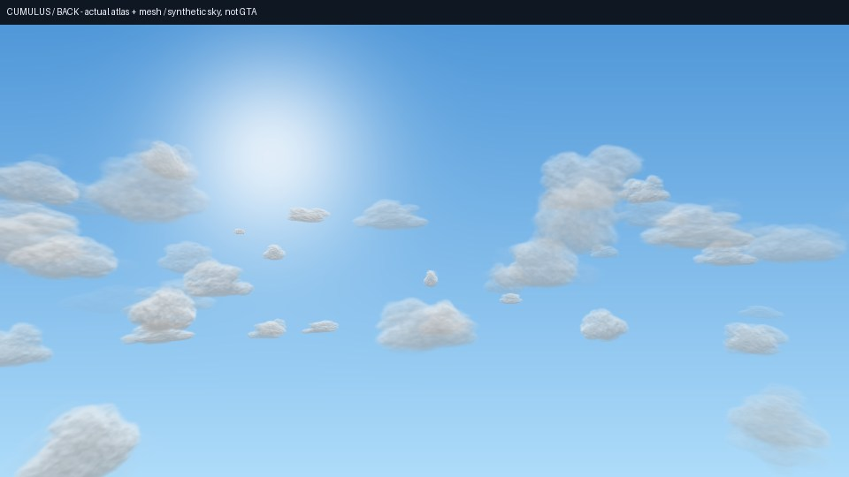 |  |
| 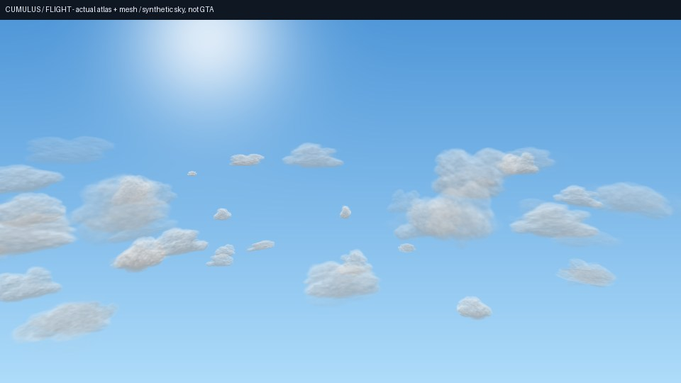 | 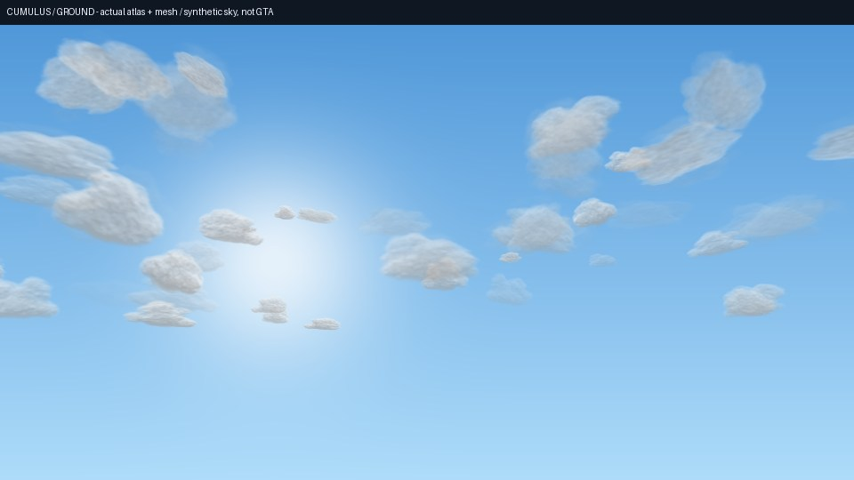 |
| 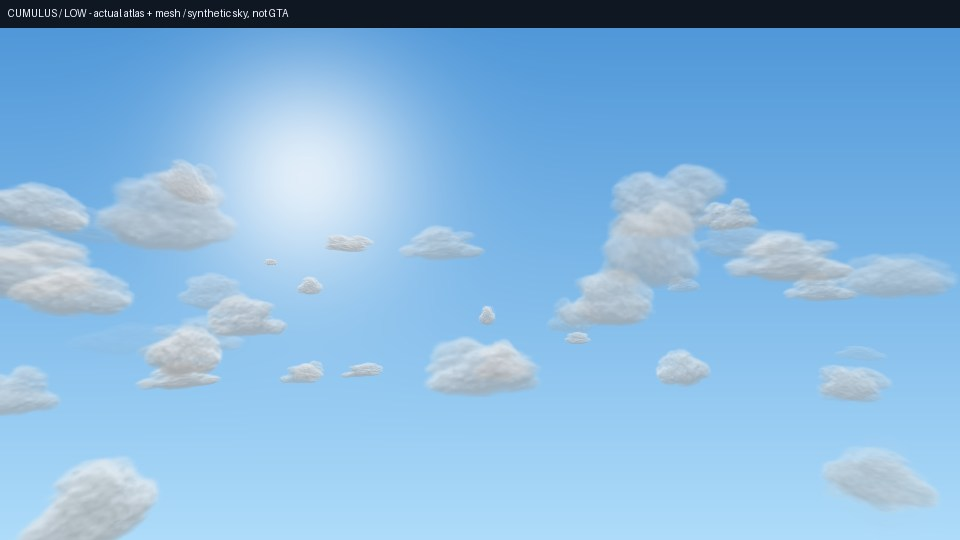 | 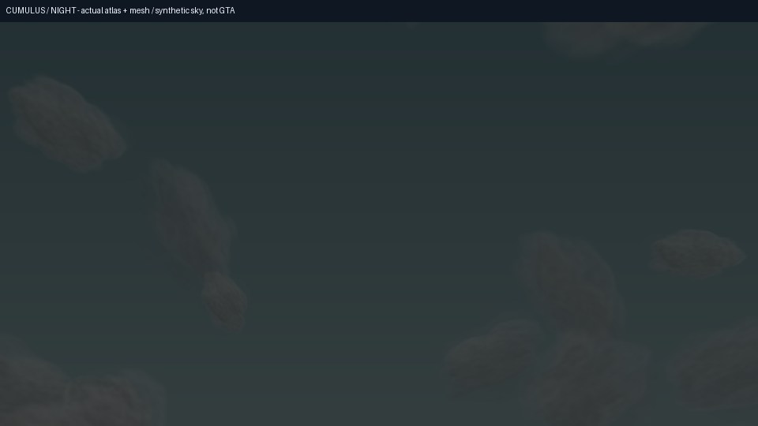 |
| 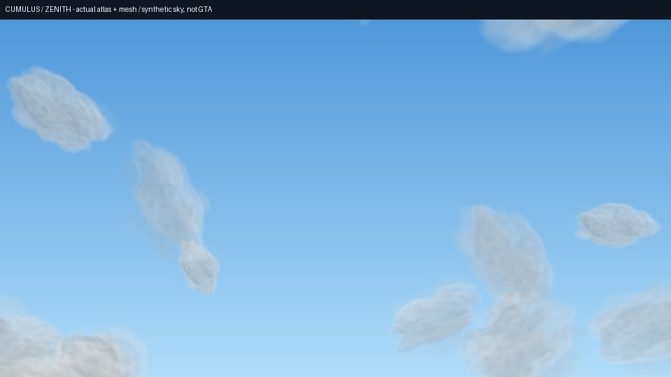 | 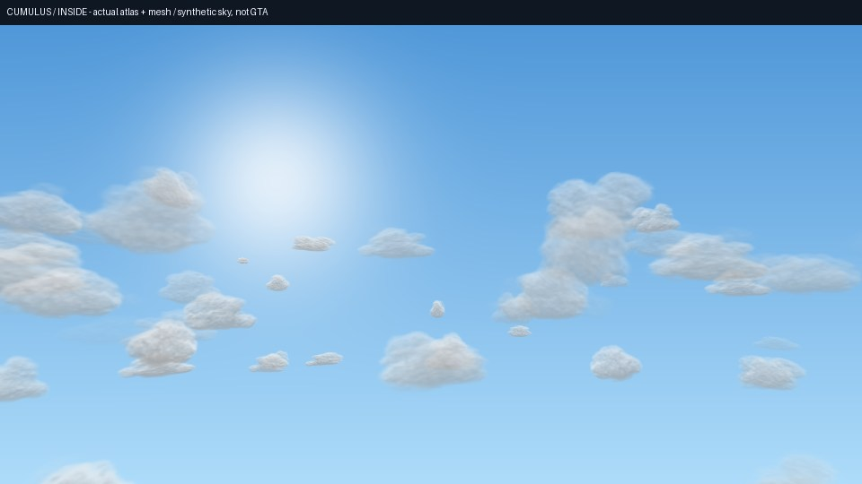 |
| 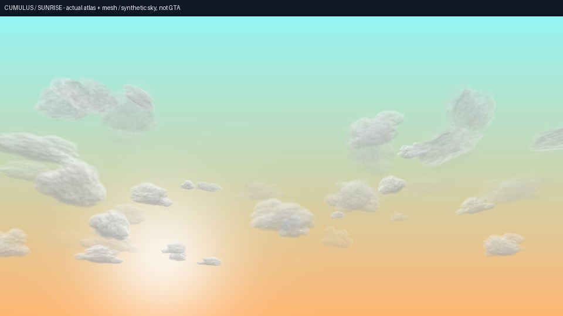 | 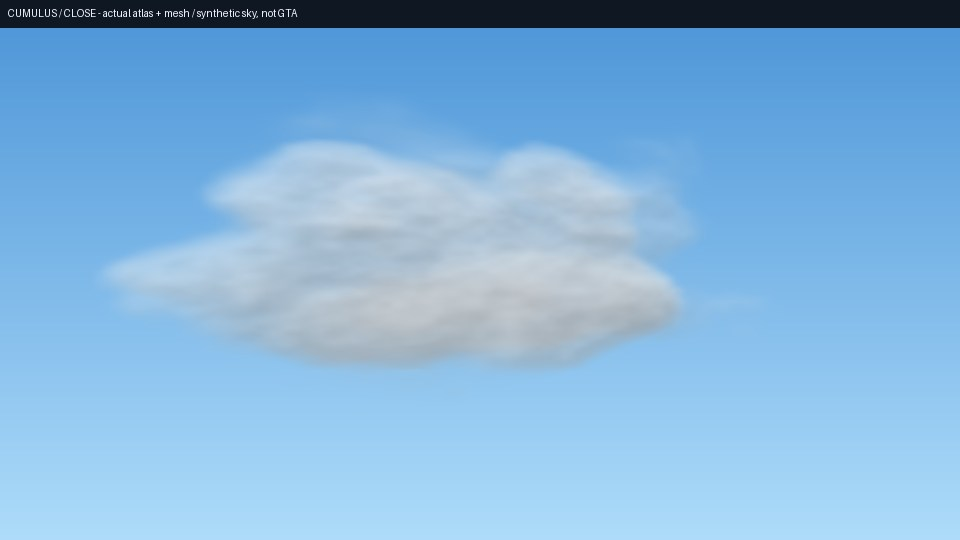 |

| Identical world field, camera Z=30 | Camera Z=210 | Camera Z=390 |
|---|---|---|
| 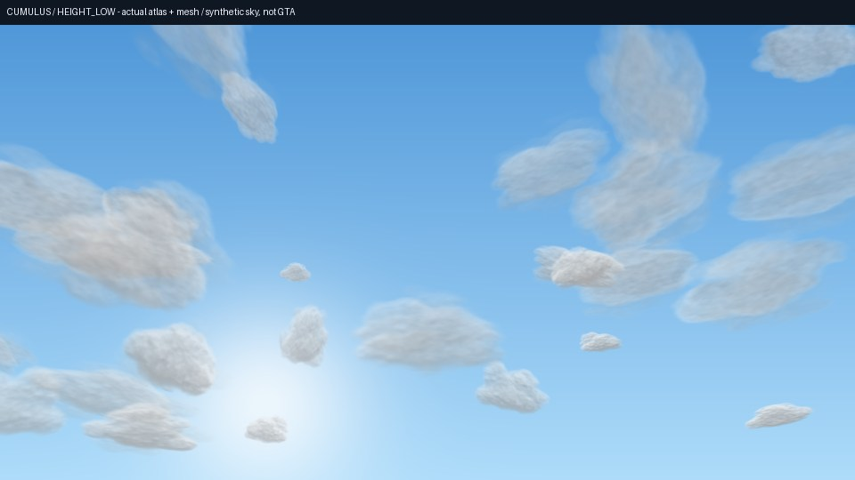 | 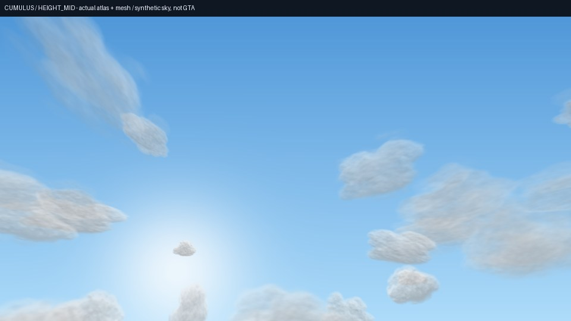 |  |

These are offline renders of the actual C++ atlas, mesh, UVs and vertex
colours. The sky and sun glare are illustrative backgrounds, not GTA assets,
and the preview omits near-plane-crossing cards rather than clipping them.
The altitude sequence retains the same field and view axes; changes represent
perspective and opacity weights, not rotation of the cloud geometry. The
historical previews with a `_previous` or `_layers` suffix remain as
references for the old implementation, not current output.

## Build

Exact Plugin-SDK revision: [624a6a49265fd7a6fc63bda1611013ceabeacb8a](https://github.com/DK22Pac/plugin-sdk/commit/624a6a49265fd7a6fc63bda1611013ceabeacb8a)
(October 25, 2025). GitHub Actions builds the SDK and plugin using Visual Studio
2022 Win32 and uploads an ASI + PDB package. Local Windows build:

```powershell
$env:PLUGIN_SDK_DIR = "C:\path\to\plugin-sdk"
# From the pinned SDK checkout:
& "$env:PLUGIN_SDK_DIR\tools\premake\premake5.exe" vs2022 --file="$env:PLUGIN_SDK_DIR\tools\premake\premake5.lua"
msbuild plugin.sln /p:Configuration=Release '/p:Platform=Mixed Platforms' /t:plugin_sa /m
# From this repository:
cmake -S . -B build -G "Visual Studio 17 2022" -A Win32
cmake --build build --config Release
ctest --test-dir build -C Release --output-on-failure
```

Portable regression tests on Linux (no game required):

```sh
g++ -std=c++17 -O2 -Wall -Wextra -Werror tests/cloud_tests.cpp -o cloud_tests
./cloud_tests
g++ -std=c++17 -O2 -Wall -Wextra -Werror tests/cumulus_tests.cpp -o cumulus_tests
./cumulus_tests
```

## Engine reference

Reviewed gta-reversed [Clouds.cpp](https://github.com/gta-reversed/gta-reversed/blob/85bce0be4bd3229eb5ef445d3a7ac2e611a994f4/source/game_sa/Clouds.cpp),
[app_game.cpp](https://github.com/gta-reversed/gta-reversed/blob/85bce0be4bd3229eb5ef445d3a7ac2e611a994f4/source/app/app_game.cpp)
and [Weather.cpp](https://github.com/gta-reversed/gta-reversed/blob/85bce0be4bd3229eb5ef445d3a7ac2e611a994f4/source/game_sa/Weather.cpp)
and the supplied SA 1.0 function index and disassembly dump. The native renderer uses three orthogonal planes at
`0x716380` and is called during `RenderEffects` at `0x53E170`, after moving fog and before
searchlights/post-effects, **not** inside `CClouds::Render`. The original repository's
call site `0x53E1B4` is verified against the IDB disassembly (part 06, E8 C7 81 1D 00) and retained with a runtime opcode/target check.
See [handoff](new%20chat/HANDOFF.md) for implementation and verification details.

## Offline geometry previews

These images are generated from the actual portable cloud geometry using a **synthetic
texture and sky**, not GTA assets or an in-game capture. They illustrate placement
and the two geometry modes, plus the shared C++ lighting calculation; real-game
appearance must be tested separately. The last row uses identical geometry,
synthetic texture and illustrative sunrise palette; only lighting settings differ.

| Clear / clustered | Rain / clustered |
|---|---|
|  |  |
| 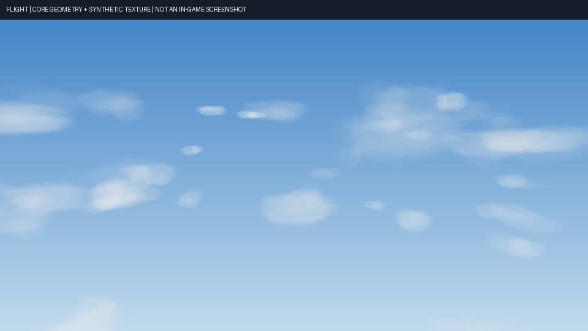 | 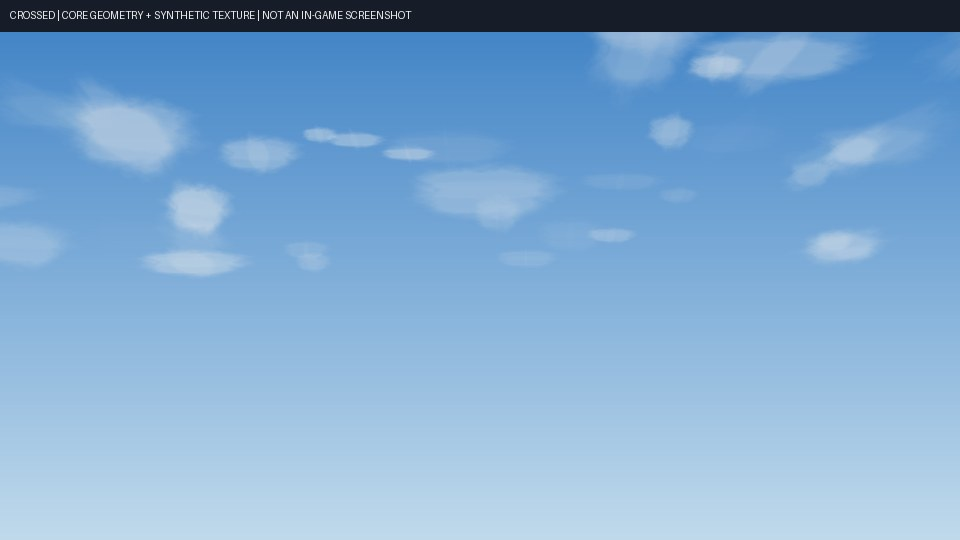 |

| Corrected sunrise (native colour) | Previous sunrise (full custom tint/shading) |
|---|---|
|  | 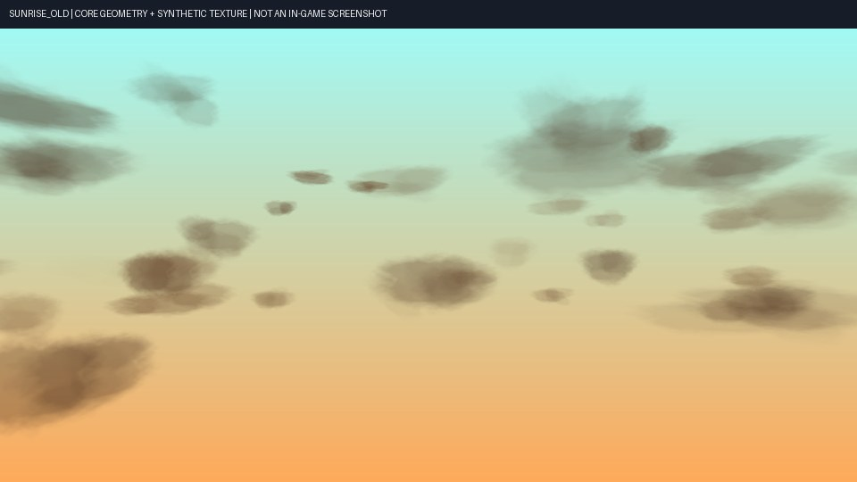 |

To regenerate the previews (requires Python, NumPy and Pillow):

```sh
g++ -std=c++17 -O2 tests/dump_preview.cpp -o dump_preview
python tests/preview.py ./dump_preview docs/previews
```

To regenerate the cumulus previews:

```sh
g++ -std=c++17 -O2 tests/cumulus_preview.cpp -o cumulus_preview
python tests/cumulus_preview.py ./cumulus_preview docs/previews
```
