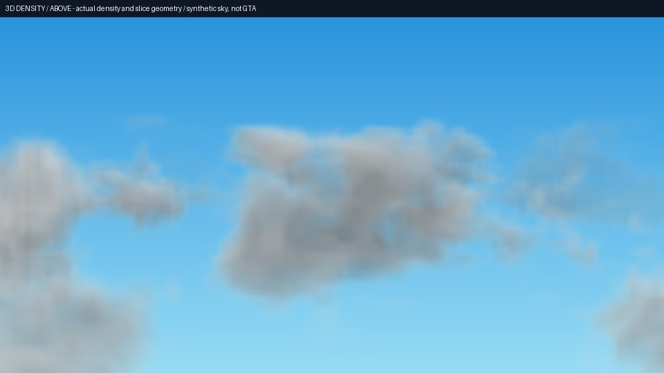
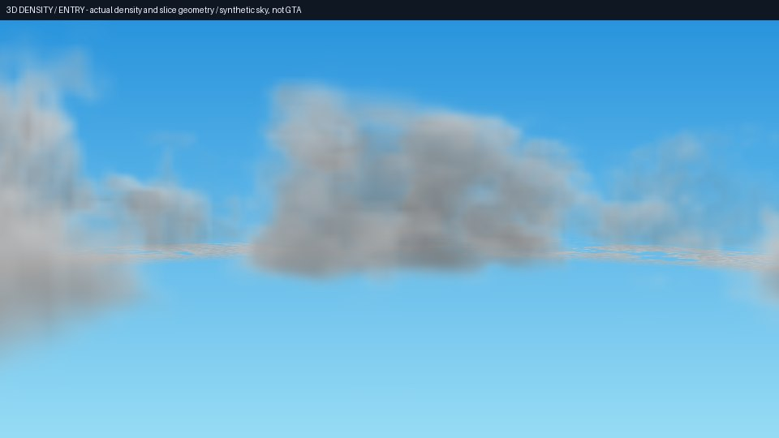
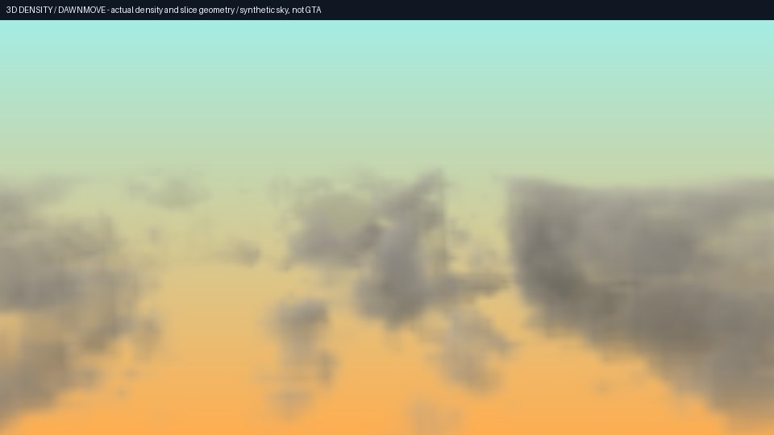

# VolumetricCloudsExtended.SA

A procedural replacement for GTA San Andreas' stock intersecting-card volumetric clouds.
The default renderer combines a world-space continuous 3D density layer with the
distant procedural canopy. It uses hardware-filtered volume texture slices and
fixed-function blending, not a per-pixel raymarch shader. It only
replaces the volumetric cloud call in the original 3D effects pass. The sky background,
low clouds, moving fog, rain and other effects remain native.

## Install

Use desktop GTA SA **1.0 US**, an ASI loader, and the Win32 ASI from the GitHub
Actions build. Put it in the game directory (or an ASI-loader-supported mod directory).
The plugin creates `VolumetricCloudsExtended.ini` beside the ASI on first load and
does not overwrite an existing INI. Restart the game after editing the settings.
The accompanying log reports whether the executable and call target matched.

An unrecognized executable or an already redirected volumetric-cloud call is left
untouched. Other graphics modifications that affect the main camera/RenderWare
pipeline may still need compatibility testing.

## Renderer

- World-space cloud groups drift with the game wind and time step, not camera yaw.
- Fixed altitude band: flying upward no longer relocates the entire cloud layer.
- Area-uniform placement, bounded minimum spacing at spawn, and perimeter recycling
  after a cloud leaves view. Teleports rebuild the field around the new position.
- Smooth weather interpolation in both directions, including bad-to-bad transitions.
  Excess clouds fade out instead of remaining permanently allocated.
- Clustered native-texture clouds (mode 1): fixed crossed core
  with independently placed, deterministically tilted satellite cards,
  depth-sorted and angle-weighted. No camera-facing billboards. Increasing
  the puff count does not simply multiply opacity.
- Crossed cards (mode 0) preserve the native world-axis geometry.
- **Continuous 3D cloud banks (default, mode 2):** the canopy's macro
  coverage drives a periodic, original 3D density field with billowing
  tops, flatter bases, and soft erosion. The nearby field is sampled by
  bounded back-to-front view slices with absolute world XYZ texture
  coordinates. Rotation of the camera does not rotate the density.
  `HybridClouds=0` selects the inexpensive original canopy-only renderer.
  Optional native flight cards remain disabled by default.
- Frustum rejection, actual camera far-plane limit, smooth range and near fades,
  back-to-front view-depth ordering and bounded RenderWare batches.
- Additional textures are borrowed directly from the loaded particle TXD. Missing
  names are ignored; the native cloudhigh texture is the fallback. No global game
  RNG consumption or native cloud-table reset. Only mode 2 owns generated canopy rasters and optional D3D9 volume textures.

## INI controls

All earlier setting names are recognized (including the two legacy tint aliases).
New settings take their defaults if absent. Values are finite and clamped; invalid
text retains the default. Inline comments are supported.

| Setting | Default | Meaning |
|---|---:|---|
| TargetProcClouds | 160 | Group count in modes 0/1; coverage control in mode 2 (0 disables) |
| BadWeatherDensityMultiplier | 1.4 | Cloudy/rainy density relative to clear (0–3) |
| MinSpawnZ | 200 | Lower absolute altitude (hybrid formations stay within the band) |
| MaxSpawnZ | 650 | Upper absolute altitude |
| SpawnRadiusMin | 300 | Inner radius relative to camera; scaled if far clip is shorter |
| SpawnRadiusMax | 2200 | Outer radius; scaled to effective render distance |
| RenderMaxDist | 2200 | Hard requested distance cap, also limited by active camera |
| RespawnMaxDist | 2800 | Maximum recycling reference; clouds are not recycled while visible |
| WindMoveScale | 0.9 | Wind advection multiplier |
| MinSpacing2D | 45 | Desired horizontal spacing; bounded retries avoid stalls |
| SpawnFadeInSpeed | 0.02 | Fade speed per native time step (50 units/sec); also used for retirement |
| QuadFacingMin | 0.2 | Crossed-card mode only: minimum plane-facing weight |
| FarClipFadeRange | 450 | Requested distance fade width |
| FarClipFadeMargin | 80 | Margin before the active far plane |
| TimecycFarClipScale | 1.8 | Optional tighter timecycle-based cap, never extends projection |
| LightingMode | 0 | 0 = native high-cloud colour; 1 = custom tint, shade and haze |
| UseTimecycTint | 1 | Custom mode: use interpolated low-cloud/fluffy RGB |
| TimecycTintStrength | 0.20 | Custom mode: mix native sky grayscale and cloud tint |
| FluffyCloudBottomBlend | 0 | Custom mode: mix low-cloud and fluffy-bottom timecycle RGB |
| ColorBrightnessBoost | 64 | Addition to native sky luminance (64 is stock) |
| UseAdditionalTextures | 1 | Look for listed textures in particle.txd |
| IncludeOriginalTextureInRandom | 1 | Include native cloudhigh among variants |
| CloudTextureNames | cloud2,cloud3,cloud4 | Comma-separated names; up to 15 |
| RenderMode | 2 | 0 = crossed cards; 1 = clustered fixed world-space cards; 2 = continuous 3D banks + canopy (default) |
| CumulusDensity | 0.95 | Mode 2: opacity of the cloud texture (0–1) |
| CumulusImpostors | 1 | Legacy key, accepted but ignored |
| HybridClouds | 1 | Mode 2: continuous 3D cloud banks plus distant canopy; 0 = canopy only |
| CumulusNightLight | 1 | Mode 2: night illumination multiplier (0–2); smooth transition to daylight |
| CumulusContrast | 0.65 | Mode 2: directional relief and occlusion contrast (0–1) |
| CumulusRimStrength | 0.85 | Mode 2: subtle thin-edge illumination (0–1), no additive halo |
| CumulusDetail | 0 | Mode 2: 0 = 512² canopy masks + 128×128×32 volume endpoints, 40 m sample interval, at most 36 slices; 1 = 1024² masks + 256×256×32 volumes, 28 m interval, at most 52 slices |
| InteriorHaze | 0.85 | Mode 2: retain nearby volume opacity on cloud entry (0–1); 0 fades the closest samples |
| CanopyFlightClouds | 0 | Optional native crossed wisps near the canopy height (0–24); off for lowest cost |
| PuffsPerCloud | 5 | Mode 1: number of puffs (1–8); core uses three fixed planes, each satellite one |
| SizeScale | 1 | Group dimensions multiplier, or mode 2 world texture scale |
| Opacity | 1 | Overall cloud opacity multiplier (0–2) |
| NearFadeDistance | 25 | Fade near the camera; 0 disables |
| BottomShade | 1 | Custom mode only: bottom/vertical shading (1 disables) |
| HazeStrength | 0 | Custom mode only: blend distant cards toward sky-bottom RGB |
| UseGameFog | 0 | Use RW scene fog rather than the plugin's manual distance haze |
| Seed | 17321 | Deterministic local RNG seed |

**Lighting correction:** `LightingMode=0` now uses the native high-cloud vertex
colour from SA 1.0 US: average the six sky colour channels (integer division),
add `ColorBrightnessBoost` (native 64) and clamp to 255. All vertices use that
neutral brightness, with no extra puff/bottom shading or manual colour haze.
In modes 0/1 an older INI without `LightingMode` automatically uses this corrected lighting;
no need to delete or regenerate it. The custom lighting settings are retained,
but take effect only with `LightingMode=1`. `UseGameFog` is independently
configurable and defaults off, like the native pass.

For the stock appearance with the procedural field, use `RenderMode=0`,
`LightingMode=0`, `UseAdditionalTextures=0`, `UseGameFog=0` and
`ColorBrightnessBoost=64`. For a low-overhead clustered
configuration try `PuffsPerCloud=3`. The new renderer deliberately does not
extend the world/camera clip plane or change the game's native height-switch global.

## Continuous 3D cloud banks (mode 2, default)

Existing INIs are never overwritten. Explicit RenderMode=0 or 1 remains
unchanged. To switch an existing installation, edit and restart:

```ini
RenderMode=2
HybridClouds=1
CumulusDetail=0
CumulusDensity=0.95
CumulusContrast=0.65
CumulusRimStrength=0.85
CumulusNightLight=1
InteriorHaze=0.85
CanopyFlightClouds=0
Opacity=1
```

### One density field, not isolated impostors

The 78-view atlas, individual cumulus groups, orientation blending and
screen-space haze from earlier revisions are removed. The far canopy
remains unchanged when HybridClouds=0. In the default path it fades
toward a continuous 3D field derived from the same macro weather map.

- **Shape:** original periodic multi-scale 3D noise distorts a smoothed
  version of the canopy coverage. Height envelopes, irregular crowns,
  erosion and a flatter base form continuous banks. XYZ density remains
  in world space, translated by native wind, including during flight.
- **Lighting:** static optical-depth accumulation down the cloud column
  and four oblique density taps give stronger top/underside relief;
  a sharper density core leaves more defined gaps and taller crowns.
  Native sky/timecycle RGB and lightning are applied live, with daylight
  headroom for SA’s post-processing colour filter, especially at dawn. This is approximate baked relief, not dynamic directional
  shadowing or full multiple scattering.
- **Rendering:** ordinary hardware-filtered RGBA volume textures
  (128×128×32 each, clear/overcast endpoints). A bounded stack of
  parallel view-aligned sample planes carries actual world XYZ texture coordinates.
  Planes have a fixed 40 m (28 m in detail mode) interval and world phase
  advected by wind. Changing camera position or clip range cannot rescale
  the sampling grid as the initial volume iteration did. Pitch/yaw still
  changes quadrature orientation, but does not rotate the density itself.
  Fixed-function texture stages linearly interpolate the weather endpoints
  and multiply live vertex RGB/alpha. The indexed triangle list is submitted
  back-to-front in one draw, with existing scene depth testing, no depth
  writes, no screen render targets, no 3D noise generation per frame and
  no custom shaders. The 16×16×8 conservative occupancy map rejects
  transparent cells including a one-texel filtering halo. The active
  camera far clip remains the limit.
- **Flight:** the volume exists at its actual sampled depths, including
  in front of and behind the player/aircraft. Sampling near the eye
  creates local visibility loss, replacing the depth-unaware
  full-screen haze. Closest planes fade more gently to prevent one slice
  suddenly occupying the entire view. InteriorHaze controls the residual
  near-sample opacity rather
  than a separate overlay. There may be gaps between slices and banding
  at very close range. Limited sampling does not provide true per-pixel
  volumetric integration.
- **Cost:** one 3D draw (plus one or two existing canopy draws). Economy
  caps at 36 × 12 × 10 × 2 = 8,640 slice triangles before rejection,
  plus up to 960 distant canopy triangles; detail caps at 52 × 12 × 10 × 2.
  The usual economy flight regression submits 3,374 triangles after culling.
  Tighter spacing reduces undersampling at the cost of increased alpha fill.
  Two RGBA volume textures occupy 4 MiB (16 MiB at detail 1); total
  with mipmapped canopy ~6.67 MiB / ~26.67 MiB, excluding driver overhead.
  CPU keeps the 4/16 MiB volume pixels for device restore, plus a tiny
  occupancy grid and bounded mesh buffers. No recurring texture uploads.
  GPU fill rate, particularly inside a thick overcast, matters more than
  triangle counts. Performance on old/integrated hardware is not measured.
- **Compatibility:** the direct D3D9 draw carries actual three-component
  texture coordinates, not a RenderWare 2D atlas. SA's normal pure-device
  mode is accepted. The SA 1.0 US device pointer and camera matrices are
  read directly (verified against the IDB); the SDK's device getter
  invalidates RW's matrix cache and is deliberately avoided. Pipeline
  state is captured/restored via D3DSBT_ALL, with no prohibited pure-device
  state getters. RW's pending states are flushed first. Volume textures
  are uploaded through system-memory staging into the default pool; a
  managed-pool attempt and smaller power-of-two textures are tried on
  failure. Lower-capability hardware can use point sampling and, only
  if two-volume blending is unavailable, the nearest weather endpoint.
  No volume support or failed draws retain the canopy. Upload failures
  log the precise operation and HRESULT, and a successful first draw
  logs submitted slice/triangle counts. A one-shot optional asynchronous
  GPU occlusion query records depth-passing samples without waiting.
  Device loss/reset and RW shutdown release owned resources.
- **Initialization:** the original map and volume are generated once on
  the game thread. The economy volume bake measured ~0.18 s in local Linux
  release tests (plus canopy generation/upload); high detail takes longer.
  First-use hitch is possible, unlike the old gradual atlas bake.

The target is convincing 2013-era cloud volumes at 2004-game budgets,
not a recreation of Rockstar assets or renderer. References:
[Rockstar's RDR2 atmospheric rendering presentation](https://advances.realtimerendering.com/s2019/),
[GPU Gems 1, chapter 39: Volume Rendering Techniques](https://developer.nvidia.com/gpugems/gpugems/part-vi-beyond-triangles/chapter-39-volume-rendering-techniques),
[Direct3D 9 volume textures](https://learn.microsoft.com/en-us/windows/win32/direct3d9/volume-texture-resources),
[Unity community cloud renderer](https://github.com/jaagupku/volumetric-clouds)
(weather mask, vertical profile, erosion), and
[Project V Atmosphere](https://github.com/rsrodev/ProjectVAtmosphere)
(reference for modern volume costs, not copied code or architecture).
A future optional simple shader could combine density integration and
lighting in fewer passes; it is not required in this iteration.

### Native weather synchronization

Mode 2 takes the game's already-interpolated `CWeather::CloudCoverage`,
`Foggyness` and `ExtraSunnyness` every frame. Rainy and sandstorm intent are
interpolated from the old/new weather types and `InterpolationValue`.
The independently step-limited rain/dust particle intensities do not
hold the cloud field in an old weather state after a forced weather
change (script-forced rain can additionally contribute). Fog and dust
reduce cloud visibility, extra-sunny reduces coverage opacity, and
lightning follows `LightningFlash` immediately. Native interpolated sky
and timecycle colors set live brightness; ordinary weather changes no
longer initiate or wait for texture generation.

The canopy uses two correlated static masks: base coverage and extra
coverage. Their alpha composition matches both baked endpoints at full
geometry opacity; intermediate coverage and edge fades are approximate.
If the density multiplier is below one, the mask weights reverse.
On hardware with dual-volume support, the nearby volume interpolates two density endpoints in the same draw.
Modes 0/1 retain their existing weather behavior.

### Runtime validation and diagnostics

The Win32 CTest `cloud_d3d9_volume` creates a native D3D9 device (attempts SA's
pure-device flags first), uploads actual 3D textures with the same backend
as the ASI, draws the clear/intermediate/wet endpoints, and reads pixels
back to verify that changing the third texture coordinate changes the
output. The expanded test then uploads generated cloud density and draws the
actual perspective mesh at approximate positions from the flight recording,
checking nonempty cloud pixels, sky gaps above the layer, and intensity.
A machine without a volume-capable D3D9 device reports **skipped**,
not passed. This does not test the GTA camera or integration.

The log beside the ASI distinguishes `3D cloud device:`,
`3D cloud bank ready:`, empty camera frustum, and
`3D cloud draw submitted:`. A supported occlusion query also logs the
first draw's depth-passing sample count. If the renderer falls back,
send the new log lines including HRESULT, not only the canopy screenshot.

### Linux software diagnostics — density/mesh only

| From the ground | At aircraft altitude |
|---|---|
|  |  |
|  |  |
|  |  |
|  |  |

Actual C++ density textures and slice triangles, software-rendered with
trilinear filtering, synthetic sky, not GTA screenshots. They do not
verify that the game successfully initialized or drew the volume. The last
user-provided build log does confirm actual in-game 3D output on a pure D3D9
device; the updated sampling/lighting still need in-game visual confirmation.

```sh
g++ -std=c++17 -O2 tests/banks_preview.cpp -o banks_preview
python tests/banks_preview.py ./banks_preview docs/previews
```

### The distant canopy (also available standalone with HybridClouds=0)


A curved, textured sky layer has been practical since the fixed-function
console era. References: [Quake III tr_sky.c](https://github.com/id-Software/Quake-III-Arena/blob/master/code/renderer/tr_sky.c)
(curved cloud texture coordinates), [OpenMW sky.cpp](https://github.com/OpenMW/openmw/blob/master/apps/openmw/mwrender/sky.cpp)
(scrolling UVs and weather transitions), [SimGear cloud.cxx](https://github.com/FlightGear/simgear/blob/next/simgear/scene/sky/cloud.cxx)
(layer altitude, thickness and coverage), and
[Adrian Courrèges' GTA V frame capture](https://www.adriancourreges.com/blog/2015/11/02/gta-v-graphics-study/)
(the game uses a sky dome and a distant cloud ring with seamless density and normal textures).
Here directional lighting and shape are baked into original procedural pixels,
not a copy of any game's assets, code or shaders.

- **Shape:** periodic, domain-warped multi-scale value noise and cellular
  billows form connected banks with gaps and finer detail. Coverage changes
  with the interpolated weather and configured group count/multiplier.
  The same cloud map drifts with native wind; the weather threshold exposes
  more or less of the same field via two precomputed optical-alpha masks
  rather than regenerating random clouds.
- **Light:** static grayscale density-gradient relief, two-scale occlusion,
  fine detail and thin-edge shading. Per-frame live vertex RGB supplies
  neutral daylight, weather dimming and restrained sunrise/sunset warmth;
  nighttime uses the timecycle sky, not the stock +64 night brightness floor.
  Modes 0/1 retain their exact native/custom lighting options.
- **Geometry:** 257 vertices and 480 indexed triangles in one 32-segment,
  8-ring shallow disk. Absolute layer altitude and world-XY UVs stay stable
  under yaw, pitch, roll and camera altitude. The finite disk is recentered
  horizontally to cover the active camera clip region; only its gentle
  outer curvature and distance fade are camera-relative. There is no
  facing sprite, texture rotation, or per-cloud sort in the default path.
  Near the surface the alpha fades locally to avoid a hard sheet crossing
  the camera. The two-sided mesh is depth-tested against world geometry.
- **Cost:** one or two fixed-function texture+alpha blend submissions, no
  per-frame cloud raymarch, custom vertex/pixel shader, screen copy,
  3D GPU texture or render target. Economy uses two 512² RGBA masks
  (~2.67 MiB with mipmaps); detail 1 uses two 1024² masks (~10.67 MiB
  with mipmaps). The CPU scalar map, RGBA and RW staging are freed after
  initial upload. No subsequent canopy texture uploads for weather or
  lighting. Empty masks are skipped; clear usually needs only one pass.
  Automatic RW mipmaps are requested, with non-mipmapped fallback if
  unavailable; detail allocation failure retries economy. Texture creation
  or upload failure falls back to mode 0 and logs it. All owned resources
  are destroyed at RW shutdown.
- **Flight:** the canopy is a thin fake cloud surface, not a true 3D volume.
  In canopy-only mode, optional supplemental wisps use CanopyFlightClouds=12 (max 24); these
  native crossed wisps appear only near the center altitude, with
  altitude/range fading. They are optional because they add alpha overdraw
  and can reveal card geometry. The default purposely omits these optional native cards.

Mode 2 uses HybridClouds, CumulusDetail, CumulusDensity, CumulusContrast, CumulusRimStrength,
CumulusNightLight, InteriorHaze, TargetProcClouds, BadWeatherDensityMultiplier, SizeScale,
Opacity, Seed, WindMoveScale, the altitude and range/fade controls, and
UseGameFog. ColorBrightnessBoost sets the native luminance reference for
daylight; LightingMode and tint settings affect only native cards.
CumulusImpostors is accepted as a legacy no-op. PuffsPerCloud affects only
mode 1. Texture names, spacing, and group spawn radius controls apply to
native cards (including optional flight wisps), not the procedural sheet.

### Previous canopy-only Linux software previews

| Day | Overhead |
|---|---|
|  |  |
|  |  |
|  |  |

These render the actual C++ procedural texture and geometry against a
synthetic sky, clipping triangles at the near plane and perspective-correctly
sampling UVs. Not screenshots of GTA, no optional native wisps or RW mipmaps
simulated in this diagnostic. The above-layer view still exposes the sheet
at grazing angles. Real-game appearance, device behavior and GPU fill rate
remain to be validated. Historical cumulus images are previous versions.

## Build

Exact Plugin-SDK revision: [624a6a49265fd7a6fc63bda1611013ceabeacb8a](https://github.com/DK22Pac/plugin-sdk/commit/624a6a49265fd7a6fc63bda1611013ceabeacb8a)
(October 25, 2025). GitHub Actions builds the SDK and plugin using Visual Studio
2022 Win32 and uploads an ASI + PDB package. Local Windows build:

```powershell
$env:PLUGIN_SDK_DIR = "C:\path\to\plugin-sdk"
# From the pinned SDK checkout:
& "$env:PLUGIN_SDK_DIR\tools\premake\premake5.exe" vs2022 --file="$env:PLUGIN_SDK_DIR\tools\premake\premake5.lua"
msbuild plugin.sln /p:Configuration=Release '/p:Platform=Mixed Platforms' /t:plugin_sa /m
# From this repository:
cmake -S . -B build -G "Visual Studio 17 2022" -A Win32
cmake --build build --config Release
ctest --test-dir build -C Release --output-on-failure
```

Portable regression tests on Linux (no game required):

```sh
g++ -std=c++17 -O2 -Wall -Wextra -Werror tests/cloud_tests.cpp -o cloud_tests
./cloud_tests
g++ -std=c++17 -O2 -Wall -Wextra -Werror -Dnear= -Dfar= tests/canopy_tests.cpp -o canopy_tests
./canopy_tests
g++ -std=c++17 -O2 -Wall -Wextra -Werror -Dnear= -Dfar= tests/weather_tests.cpp -o weather_tests
./weather_tests
g++ -std=c++17 -O2 -Wall -Wextra -Werror -Dnear= -Dfar= tests/banks_tests.cpp -o banks_tests
./banks_tests
```

## Engine reference

Reviewed gta-reversed [Clouds.cpp](https://github.com/gta-reversed/gta-reversed/blob/85bce0be4bd3229eb5ef445d3a7ac2e611a994f4/source/game_sa/Clouds.cpp),
[app_game.cpp](https://github.com/gta-reversed/gta-reversed/blob/85bce0be4bd3229eb5ef445d3a7ac2e611a994f4/source/app/app_game.cpp),
 [TimeCycle.cpp](https://github.com/gta-reversed/gta-reversed/blob/85bce0be4bd3229eb5ef445d3a7ac2e611a994f4/source/game_sa/TimeCycle.cpp)
and [Weather.cpp](https://github.com/gta-reversed/gta-reversed/blob/85bce0be4bd3229eb5ef445d3a7ac2e611a994f4/source/game_sa/Weather.cpp)
and the supplied SA 1.0 function index and disassembly dump. The native renderer uses three orthogonal planes at
`0x716380` and is called during `RenderEffects` at `0x53E170`, after moving fog and before
searchlights/post-effects, **not** inside `CClouds::Render`. The original repository's
call site `0x53E1B4` is verified against the IDB disassembly (part 06, E8 C7 81 1D 00) and retained with a runtime opcode/target check.
See [handoff](new%20chat/HANDOFF.md) for implementation and verification details.

## Offline geometry previews

These images are generated from the actual portable cloud geometry using a **synthetic
texture and sky**, not GTA assets or an in-game capture. They illustrate placement
and the two geometry modes, plus the shared C++ lighting calculation; real-game
appearance must be tested separately. The last row uses identical geometry,
synthetic texture and illustrative sunrise palette; only lighting settings differ.

| Clear / clustered | Rain / clustered |
|---|---|
|  |  |
|  |  |

| Corrected sunrise (native colour) | Previous sunrise (full custom tint/shading) |
|---|---|
|  |  |

To regenerate the previews (requires Python, NumPy and Pillow):

```sh
g++ -std=c++17 -O2 tests/dump_preview.cpp -o dump_preview
python tests/preview.py ./dump_preview docs/previews
```

To regenerate the canopy previews:

```sh
g++ -std=c++17 -O2 tests/canopy_preview.cpp -o canopy_preview
python tests/canopy_preview.py ./canopy_preview docs/previews
```
