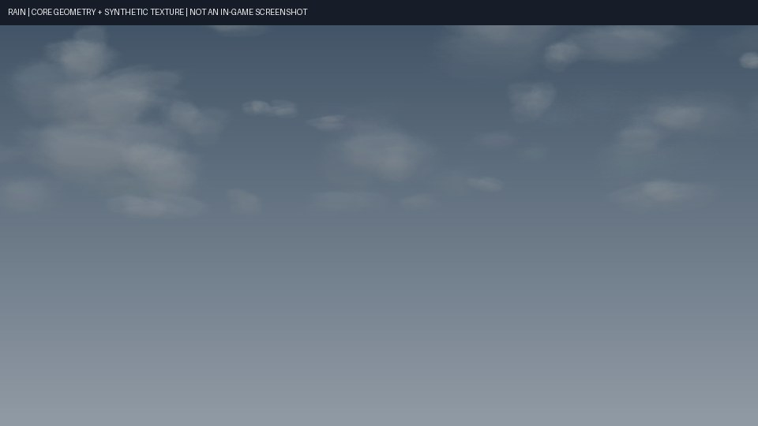

# VolumetricCloudsExtended.SA

A procedural replacement for GTA San Andreas' stock intersecting-card volumetric clouds.
This is a textured 3D impostor renderer, not a raymarched atmospheric volume. It only
replaces the volumetric cloud call in the original 3D effects pass. The sky background,
low clouds, moving fog, rain and other effects remain native.

## Install

Use desktop GTA SA **1.0 US**, an ASI loader, and the Win32 ASI from the GitHub
Actions build. Put it in the game directory (or an ASI-loader-supported mod directory).
The plugin creates `VolumetricCloudsExtended.ini` beside the ASI on first load and
does not overwrite an existing INI. Restart the game after editing the settings.
The accompanying log reports whether the executable and call target matched.

An unrecognized executable or an already redirected volumetric-cloud call is left
untouched. Other graphics modifications that affect the main camera/RenderWare
pipeline may still need compatibility testing.

## Renderer

- World-space cloud groups drift with the game wind and time step, not camera yaw.
- Fixed altitude band: flying upward no longer relocates the entire cloud layer.
- Area-uniform placement, bounded minimum spacing at spawn, and perimeter recycling
  after a cloud leaves view. Teleports rebuild the field around the new position.
- Smooth weather interpolation in both directions, including bad-to-bad transitions.
  Excess clouds fade out instead of remaining permanently allocated.
- Clustered impostors (default): independently positioned soft cards form a cloud
  group. Each card faces the camera and is depth-sorted, with stable world positions,
  varied sizes/rolls and mild vertical shading. Increasing the card count does not
  simply multiply opacity.
- Crossed cards remain selectable for the native appearance.
- Frustum rejection, actual camera far-plane limit, smooth range and near fades,
  back-to-front view-depth ordering and bounded RenderWare batches.
- Additional textures are borrowed directly from the loaded particle TXD. Missing
  names are ignored; the native cloudhigh texture is the fallback. No global game
  RNG consumption, native cloud-table reset or persistent graphics resources.

## INI controls

All earlier setting names are recognized (including the two legacy tint aliases).
New settings take their defaults if absent. Values are finite and clamped; invalid
text retains the default. Inline comments are supported.

| Setting | Default | Meaning |
|---|---:|---|
| TargetProcClouds | 160 | Clear-weather cloud groups (0–512) |
| BadWeatherDensityMultiplier | 1.4 | Cloudy/rainy density relative to clear (0–3) |
| MinSpawnZ | 200 | Lower absolute altitude |
| MaxSpawnZ | 650 | Upper absolute altitude |
| SpawnRadiusMin | 300 | Inner radius relative to camera; scaled if far clip is shorter |
| SpawnRadiusMax | 2200 | Outer radius; scaled to effective render distance |
| RenderMaxDist | 2200 | Hard requested distance cap, also limited by active camera |
| RespawnMaxDist | 2800 | Maximum recycling reference; clouds are not recycled while visible |
| WindMoveScale | 0.9 | Wind advection multiplier |
| MinSpacing2D | 45 | Desired horizontal spacing; bounded retries avoid stalls |
| SpawnFadeInSpeed | 0.02 | Fade speed per native time step (50 units/sec); also used for retirement |
| QuadFacingMin | 0.2 | Crossed-card mode only: minimum plane-facing weight |
| FarClipFadeRange | 450 | Requested distance fade width |
| FarClipFadeMargin | 80 | Margin before the active far plane |
| TimecycFarClipScale | 1.8 | Optional tighter timecycle-based cap, never extends projection |
| UseTimecycTint | 1 | Use interpolated timecycle cloud RGB |
| TimecycTintStrength | 1 | Mix native sky grayscale and cloud tint |
| FluffyCloudBottomBlend | 0 | Mix low-cloud and fluffy-bottom timecycle RGB |
| ColorBrightnessBoost | 64 | Addition to native grayscale fallback |
| UseAdditionalTextures | 1 | Look for listed textures in particle.txd |
| IncludeOriginalTextureInRandom | 1 | Include native cloudhigh among variants |
| CloudTextureNames | cloud2,cloud3,cloud4 | Comma-separated names; up to 15 |
| RenderMode | 1 | 0 = crossed cards; 1 = clustered camera-facing cards |
| PuffsPerCloud | 5 | Number of cards per group (1–8) in clustered mode |
| SizeScale | 1 | Group dimensions multiplier |
| Opacity | 1 | Group opacity multiplier (0–2) |
| NearFadeDistance | 25 | Fade near the camera; 0 disables |
| BottomShade | 0.75 | Bottom/vertical shading strength (1 disables) |
| HazeStrength | 0.35 | Blend distant cards toward timecycle sky-bottom RGB |
| UseGameFog | 0 | Use RW scene fog rather than the plugin's manual distance haze |
| Seed | 17321 | Deterministic local RNG seed |

For a look closer to the old renderer, set `RenderMode=0`, `BottomShade=1`,
`HazeStrength=0` and optionally `UseGameFog=1`. For a low-overhead clustered
configuration try `PuffsPerCloud=3`. The new renderer deliberately does not
extend the world/camera clip plane or change the game's native height-switch global.

## Build

Exact Plugin-SDK revision: [624a6a49265fd7a6fc63bda1611013ceabeacb8a](https://github.com/DK22Pac/plugin-sdk/commit/624a6a49265fd7a6fc63bda1611013ceabeacb8a)
(October 25, 2025). GitHub Actions builds the SDK and plugin using Visual Studio
2022 Win32 and uploads an ASI + PDB package. Local Windows build:

```powershell
$env:PLUGIN_SDK_DIR = "C:\path\to\plugin-sdk"
# From the pinned SDK checkout:
& "$env:PLUGIN_SDK_DIR\tools\premake\premake5.exe" vs2022 --file="$env:PLUGIN_SDK_DIR\tools\premake\premake5.lua"
msbuild plugin.sln /p:Configuration=Release '/p:Platform=Mixed Platforms' /t:plugin_sa /m
# From this repository:
cmake -S . -B build -G "Visual Studio 17 2022" -A Win32
cmake --build build --config Release
ctest --test-dir build -C Release --output-on-failure
```

Portable regression tests on Linux (no game required):

```sh
g++ -std=c++17 -O2 -Wall -Wextra -Werror tests/cloud_tests.cpp -o cloud_tests
./cloud_tests
```

## Engine reference

Reviewed gta-reversed [Clouds.cpp](https://github.com/gta-reversed/gta-reversed/blob/85bce0be4bd3229eb5ef445d3a7ac2e611a994f4/source/game_sa/Clouds.cpp),
[app_game.cpp](https://github.com/gta-reversed/gta-reversed/blob/85bce0be4bd3229eb5ef445d3a7ac2e611a994f4/source/app/app_game.cpp)
and [Weather.cpp](https://github.com/gta-reversed/gta-reversed/blob/85bce0be4bd3229eb5ef445d3a7ac2e611a994f4/source/game_sa/Weather.cpp)
and the supplied SA 1.0 function index and disassembly dump. The native renderer uses three orthogonal planes at
`0x716380` and is called during `RenderEffects` at `0x53E170`, after moving fog and before
searchlights/post-effects, **not** inside `CClouds::Render`. The original repository's
call site `0x53E1B4` is verified against the IDB disassembly (part 06, E8 C7 81 1D 00) and retained with a runtime opcode/target check.
See [handoff](new%20chat/HANDOFF.md) for implementation and verification details.

## Offline geometry previews

These images are generated from the actual portable cloud geometry using a **synthetic
texture and sky**, not GTA assets or an in-game capture. They illustrate placement
and the two geometry modes; real-game appearance must be tested separately.

| Clear / clustered | Rain / clustered |
|---|---|
|  |  |
|  |  |

To regenerate the previews (requires Python, NumPy and Pillow):

```sh
g++ -std=c++17 -O2 tests/dump_preview.cpp -o dump_preview
python tests/preview.py ./dump_preview docs/previews
```
