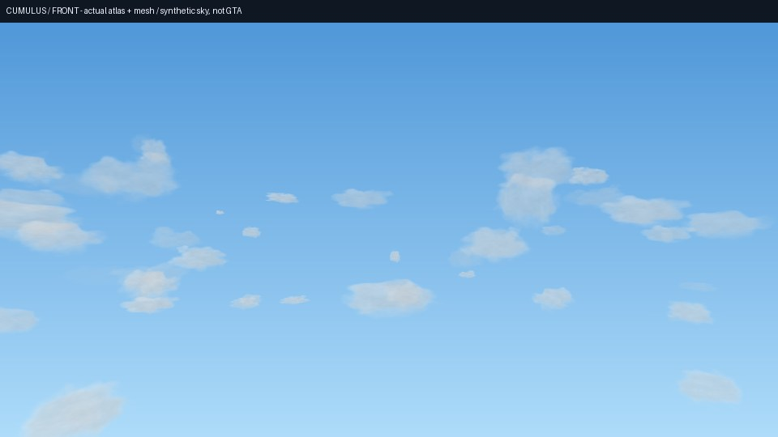
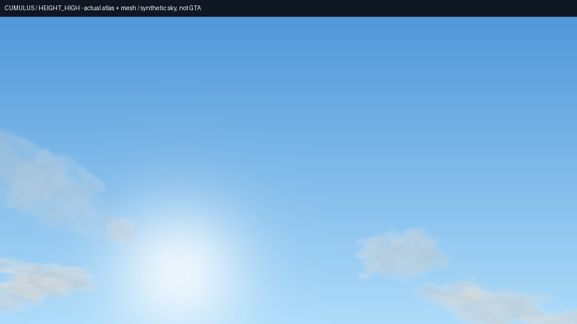
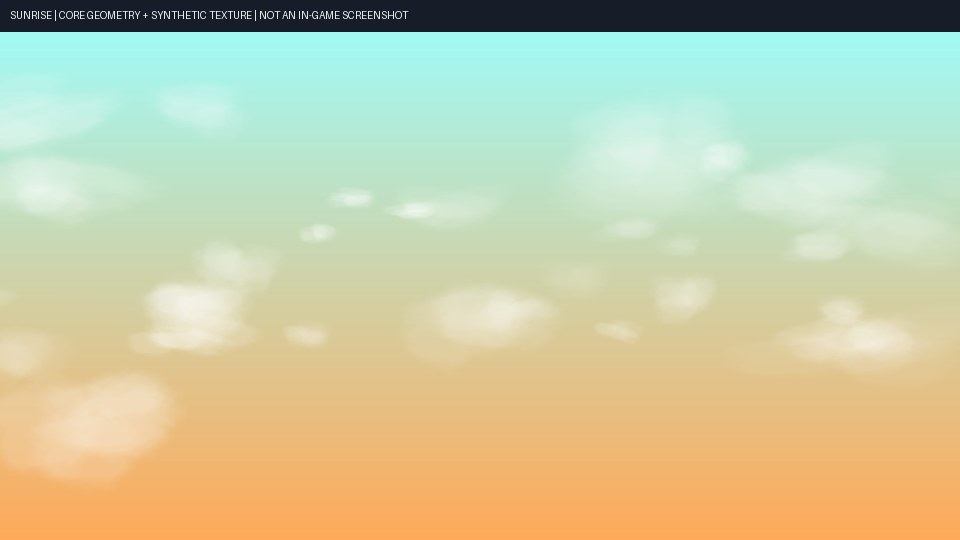

# VolumetricCloudsExtended.SA

A procedural replacement for GTA San Andreas' stock intersecting-card volumetric clouds.
This is a textured 3D impostor renderer, not a raymarched atmospheric volume. It only
replaces the volumetric cloud call in the original 3D effects pass. The sky background,
low clouds, moving fog, rain and other effects remain native.

## Install

Use desktop GTA SA **1.0 US**, an ASI loader, and the Win32 ASI from the GitHub
Actions build. Put it in the game directory (or an ASI-loader-supported mod directory).
The plugin creates `VolumetricCloudsExtended.ini` beside the ASI on first load and
does not overwrite an existing INI. Restart the game after editing the settings.
The accompanying log reports whether the executable and call target matched.

An unrecognized executable or an already redirected volumetric-cloud call is left
untouched. Other graphics modifications that affect the main camera/RenderWare
pipeline may still need compatibility testing.

## Renderer

- World-space cloud groups drift with the game wind and time step, not camera yaw.
- Fixed altitude band: flying upward no longer relocates the entire cloud layer.
- Area-uniform placement, bounded minimum spacing at spawn, and perimeter recycling
  after a cloud leaves view. Teleports rebuild the field around the new position.
- Smooth weather interpolation in both directions, including bad-to-bad transitions.
  Excess clouds fade out instead of remaining permanently allocated.
- Clustered impostors (default): independently positioned soft cards form a cloud
  group. Each card faces the camera and is depth-sorted, with stable world positions,
  varied sizes/rolls and native lighting (optional custom shading). Increasing the card count does not
  simply multiply opacity.
- Crossed cards remain selectable for the native appearance.
- Experimental shader-free cumulus mode (opt-in): airy, procedurally textured
  clouds on three **fixed world-space planes** with separate projections of
  a common density field, gentle sunlight and restrained night illumination.
  Geometry, UVs and the light gradient do not rotate as the camera moves.
  The economy setting draws at most six triangles per cloud. No external
  texture or shader dependency.
- Frustum rejection, actual camera far-plane limit, smooth range and near fades,
  back-to-front view-depth ordering and bounded RenderWare batches.
- Additional textures are borrowed directly from the loaded particle TXD. Missing
  names are ignored; the native cloudhigh texture is the fallback. No global game
  RNG consumption or native cloud-table reset. Only optional cumulus mode owns
  a small ordinary RW texture raster.

## INI controls

All earlier setting names are recognized (including the two legacy tint aliases).
New settings take their defaults if absent. Values are finite and clamped; invalid
text retains the default. Inline comments are supported.

| Setting | Default | Meaning |
|---|---:|---|
| TargetProcClouds | 160 | Clear-weather cloud groups (0–512) |
| BadWeatherDensityMultiplier | 1.4 | Cloudy/rainy density relative to clear (0–3) |
| MinSpawnZ | 200 | Lower absolute altitude |
| MaxSpawnZ | 650 | Upper absolute altitude |
| SpawnRadiusMin | 300 | Inner radius relative to camera; scaled if far clip is shorter |
| SpawnRadiusMax | 2200 | Outer radius; scaled to effective render distance |
| RenderMaxDist | 2200 | Hard requested distance cap, also limited by active camera |
| RespawnMaxDist | 2800 | Maximum recycling reference; clouds are not recycled while visible |
| WindMoveScale | 0.9 | Wind advection multiplier |
| MinSpacing2D | 45 | Desired horizontal spacing; bounded retries avoid stalls |
| SpawnFadeInSpeed | 0.02 | Fade speed per native time step (50 units/sec); also used for retirement |
| QuadFacingMin | 0.2 | Crossed-card mode only: minimum plane-facing weight |
| FarClipFadeRange | 450 | Requested distance fade width |
| FarClipFadeMargin | 80 | Margin before the active far plane |
| TimecycFarClipScale | 1.8 | Optional tighter timecycle-based cap, never extends projection |
| LightingMode | 0 | 0 = native high-cloud colour; 1 = custom tint, shade and haze |
| UseTimecycTint | 1 | Custom mode: use interpolated low-cloud/fluffy RGB |
| TimecycTintStrength | 0.20 | Custom mode: mix native sky grayscale and cloud tint |
| FluffyCloudBottomBlend | 0 | Custom mode: mix low-cloud and fluffy-bottom timecycle RGB |
| ColorBrightnessBoost | 64 | Addition to native sky luminance (64 is stock) |
| UseAdditionalTextures | 1 | Look for listed textures in particle.txd |
| IncludeOriginalTextureInRandom | 1 | Include native cloudhigh among variants |
| CloudTextureNames | cloud2,cloud3,cloud4 | Comma-separated names; up to 15 |
| RenderMode | 1 | 0 = crossed cards; 1 = clustered camera-facing cards; 2 = experimental shader-free cumulus |
| CumulusDensity | 0.95 | Mode 2: optical density multiplier (0–1) |
| CumulusImpostors | 1 | Legacy key, accepted but ignored; mode 2 always uses fixed geometry |
| CumulusNightLight | 1 | Mode 2: night illumination multiplier (0–2); smooth transition to daylight |
| CumulusContrast | 0.65 | Mode 2: directional and underside lighting contrast (0–1) |
| CumulusRimStrength | 0.85 | Mode 2: subtle sunward edge softening (0–1), never above native daytime luminance |
| CumulusDetail | 0 | Mode 2: 0 = 2×2 grid (up to 6 triangles/cloud); 1 = 3×3 (up to 24 triangles/cloud) |
| PuffsPerCloud | 5 | Number of cards per group (1–8) in clustered mode (1) only |
| SizeScale | 1 | Group dimensions multiplier |
| Opacity | 1 | Group opacity multiplier (0–2) |
| NearFadeDistance | 25 | Fade near the camera; 0 disables |
| BottomShade | 1 | Custom mode only: bottom/vertical shading (1 disables) |
| HazeStrength | 0 | Custom mode only: blend distant cards toward sky-bottom RGB |
| UseGameFog | 0 | Use RW scene fog rather than the plugin's manual distance haze |
| Seed | 17321 | Deterministic local RNG seed |

**Lighting correction:** `LightingMode=0` now uses the native high-cloud vertex
colour from SA 1.0 US: average the six sky colour channels (integer division),
add `ColorBrightnessBoost` (native 64) and clamp to 255. All vertices use that
neutral brightness, with no extra puff/bottom shading or manual colour haze.
An older INI without `LightingMode` automatically uses this corrected mode;
no need to delete or regenerate it. The custom lighting settings are retained,
but take effect only with `LightingMode=1`. `UseGameFog` is independently
configurable and defaults off, like the native pass.

For the stock appearance with the procedural field, use `RenderMode=0`,
`LightingMode=0`, `UseAdditionalTextures=0`, `UseGameFog=0` and
`ColorBrightnessBoost=64`. For a low-overhead clustered
configuration try `PuffsPerCloud=3`. The new renderer deliberately does not
extend the world/camera clip plane or change the game's native height-switch global.

## Experimental cumulus mode (no shaders)

Add or change these values in your existing INI, then restart:

```ini
RenderMode=2
CumulusDetail=0
CumulusDensity=0.95
CumulusNightLight=1
CumulusContrast=0.65
CumulusRimStrength=0.85
Opacity=1
ColorBrightnessBoost=64
```

The default renderer remains mode 1, so existing installations do not switch.
Mode 2 deliberately favors a period-appropriate, semi-transparent cloud over
a near-opaque modern impostor. Mode 2 uses its own texture and lighting;
native/additional texture choice and the custom tint/shade/haze keys do not
affect it. Native sky luminance, global opacity, wind, altitude, weather,
visibility and clipping still apply. `PuffsPerCloud` applies to mode 1 only.
The obsolete `CumulusImpostors` key is accepted but ignored, so an older INI
cannot accidentally restore rotating billboards.

**World-fixed geometry:** inspired by SA's original three orthogonal planes
(see engine reference below), each group has two vertical crossed planes and
one horizontal plane. Their orientation is set by a deterministic cloud yaw
and their sizes are the actual world-axis dimensions of the cloud. They never
turn to face the player, including when moving vertically or through the cloud.
The cloud's orientation, UVs and vertex lighting depend on its geometry and
the environment only. The viewing direction changes *opacity* via squared,
normalized direction cosines. Splitting optical depth across the planes
smooths transitions at oblique angles; it is exact for equal full-mask samples
but a visual approximation for real silhouettes. Edge-on planes can be culled.
Near the center of the volume, the existing group proximity fade reduces
cockpit intersections. There is no billboard-distance LOD or view-basis flip.

**Textures:** the one-time CPU bake projects four deterministic, irregular
3D lobe fields into three corresponding 128×128 textures each (XZ, YZ, XY).
The twelve tiles fit a single 512×512 RGBA atlas (~1 MiB raw, as before).
Integrated optical thickness, gentle erosion, organic density variation and
a neutral low-contrast grayscale texture create soft fringes and avoid
hard sphere boundaries. The coherent horizontal projection is particularly
important when looking up from the ground. Cloud opacity is less aggressive
than the previous nearly opaque body-plus-puff mode.

**Lighting:** the game's current sun vector and native neutral daytime
luminance drive world-aligned gradients; texture RGB provides restrained
density relief rather than exaggerated color or a white outline. Sunward
edge softening never exceeds native daytime luminance. Night uses a small
ambient floor and sky luminance, and a weak lunar directional gradient gated
by an approximate midnight window and weather. `CumulusNightLight` scales
night illumination. No brightness-equation changes to modes 0 or 1.

**Cost:** at detail 0 each plane uses four vertices and two triangles (up to
12 vertices and six triangles per cloud); detail 1 uses nine vertices and
eight triangles per plane (up to 27 vertices and 24 triangles per cloud).
For 160 clouds this is at most 960/3840 triangles before culling, respectively.
One fixed-function texture/blend pass, one shared atlas, same bounded
RenderWare batches, no shaders, runtime raymarches, scene copies, extra
targets or post-processing. Allocation failure falls back to mode 0 and is
logged; the texture is destroyed before RenderWare shutdown. Fresh INIs
default to detail 0. An existing INI with detail 1 stays at detail 1.
If fill-rate is the bottleneck, reduce `TargetProcClouds`: all transparent
renderers still incur overdraw and three intersecting planes may cover more
pixels than one old impostor from oblique angles. This is not a measured
performance guarantee.

The implementation and textures are original. It's still an approximation,
not a raymarched volume. At very close range or some oblique angles flat
intersections can become apparent; retaining this limitation is preferable
to introducing expensive rendering passes for the target hardware.

| Looking toward the sun | Looking away |
|---|---|
|  |  |
|  |  |
|  |  |
|  |  |

| Identical world field, camera Z=30 | Camera Z=210 | Camera Z=390 |
|---|---|---|
|  |  |  |

These are offline renders of the actual C++ atlas, mesh, UVs and vertex
colours. The sky and sun glare are illustrative backgrounds, not GTA assets,
and the preview omits near-plane-crossing cards rather than clipping them.
The altitude sequence retains the same field and view axes; changes represent
perspective and opacity weights, not rotation of the cloud geometry. The
historical previews with a `_previous` or `_layers` suffix remain as
references for the old implementation, not current output.

## Build

Exact Plugin-SDK revision: [624a6a49265fd7a6fc63bda1611013ceabeacb8a](https://github.com/DK22Pac/plugin-sdk/commit/624a6a49265fd7a6fc63bda1611013ceabeacb8a)
(October 25, 2025). GitHub Actions builds the SDK and plugin using Visual Studio
2022 Win32 and uploads an ASI + PDB package. Local Windows build:

```powershell
$env:PLUGIN_SDK_DIR = "C:\path\to\plugin-sdk"
# From the pinned SDK checkout:
& "$env:PLUGIN_SDK_DIR\tools\premake\premake5.exe" vs2022 --file="$env:PLUGIN_SDK_DIR\tools\premake\premake5.lua"
msbuild plugin.sln /p:Configuration=Release '/p:Platform=Mixed Platforms' /t:plugin_sa /m
# From this repository:
cmake -S . -B build -G "Visual Studio 17 2022" -A Win32
cmake --build build --config Release
ctest --test-dir build -C Release --output-on-failure
```

Portable regression tests on Linux (no game required):

```sh
g++ -std=c++17 -O2 -Wall -Wextra -Werror tests/cloud_tests.cpp -o cloud_tests
./cloud_tests
g++ -std=c++17 -O2 -Wall -Wextra -Werror tests/cumulus_tests.cpp -o cumulus_tests
./cumulus_tests
```

## Engine reference

Reviewed gta-reversed [Clouds.cpp](https://github.com/gta-reversed/gta-reversed/blob/85bce0be4bd3229eb5ef445d3a7ac2e611a994f4/source/game_sa/Clouds.cpp),
[app_game.cpp](https://github.com/gta-reversed/gta-reversed/blob/85bce0be4bd3229eb5ef445d3a7ac2e611a994f4/source/app/app_game.cpp)
and [Weather.cpp](https://github.com/gta-reversed/gta-reversed/blob/85bce0be4bd3229eb5ef445d3a7ac2e611a994f4/source/game_sa/Weather.cpp)
and the supplied SA 1.0 function index and disassembly dump. The native renderer uses three orthogonal planes at
`0x716380` and is called during `RenderEffects` at `0x53E170`, after moving fog and before
searchlights/post-effects, **not** inside `CClouds::Render`. The original repository's
call site `0x53E1B4` is verified against the IDB disassembly (part 06, E8 C7 81 1D 00) and retained with a runtime opcode/target check.
See [handoff](new%20chat/HANDOFF.md) for implementation and verification details.

## Offline geometry previews

These images are generated from the actual portable cloud geometry using a **synthetic
texture and sky**, not GTA assets or an in-game capture. They illustrate placement
and the two geometry modes, plus the shared C++ lighting calculation; real-game
appearance must be tested separately. The last row uses identical geometry,
synthetic texture and illustrative sunrise palette; only lighting settings differ.

| Clear / clustered | Rain / clustered |
|---|---|
|  |  |
|  |  |

| Corrected sunrise (native colour) | Previous sunrise (full custom tint/shading) |
|---|---|
|  |  |

To regenerate the previews (requires Python, NumPy and Pillow):

```sh
g++ -std=c++17 -O2 tests/dump_preview.cpp -o dump_preview
python tests/preview.py ./dump_preview docs/previews
```

To regenerate the cumulus previews:

```sh
g++ -std=c++17 -O2 tests/cumulus_preview.cpp -o cumulus_preview
python tests/cumulus_preview.py ./cumulus_preview docs/previews
```
